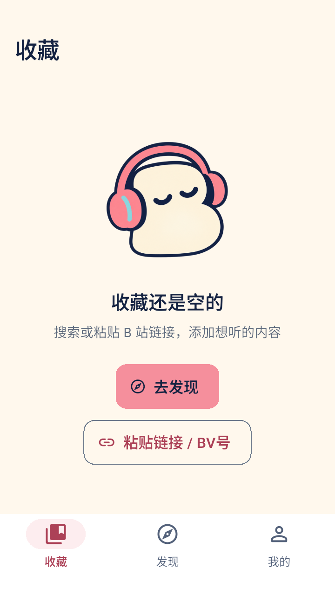
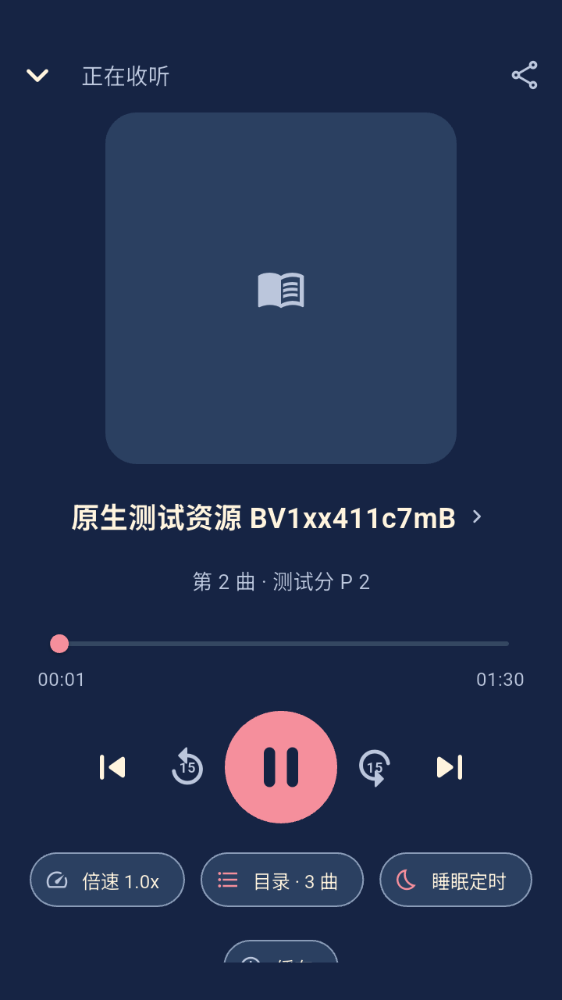
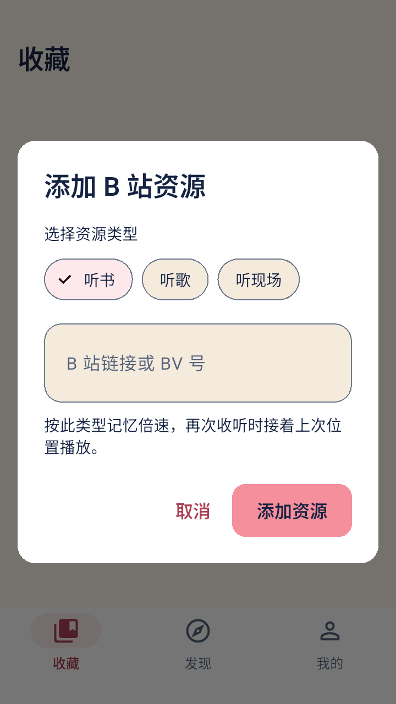

# B听（Blisten）

**闭上眼听 B 站。**

B听（Blisten）基于开源项目 [阿B听书（fengqiao57/abts）](https://github.com/fengqiao57/abts) 修改而来，在原有听书功能基础上，增加歌曲、演唱会模式、B 站链接/BV 号导入，以及按模式独立的倍速与续播规则。

感谢原项目作者及贡献者。本项目保留原始 MIT 许可证和版权声明，是独立维护的衍生版本。

本项目使用独立仓库 [AtomHH86/Blisten](https://github.com/AtomHH86/Blisten)。安装包与更新说明见 [GitHub Releases](https://github.com/AtomHH86/Blisten/releases)，问题反馈请提交 [Issue](https://github.com/AtomHH86/Blisten/issues)。后续开发以本目录为准，迁移来源见 [项目来源](docs/project-origin.md)。

## 功能

| 模式 | 搜索 | 倍速 | 重新选择资源时 |
| --- | --- | --- | --- |
| 听书 | 沿用有声小说分类、筛选和补搜 | 独立记忆，兼容旧设置 | 恢复分 P 与进度 |
| 歌曲 | 按歌名、歌手搜索，不套用听书筛选 | 初始 1.0 倍，独立记忆 | 第一 P 从头开始 |
| 演唱会 | 按歌手、场次等搜索 | 初始 1.0 倍，独立记忆 | 恢复分 P 与进度 |

- 搜索提供“听书 / 听歌 / 听现场 / UP 主”四个并列入口；UP 搜索支持分页，进入主页后可切换收听模式。
- 支持粘贴 BV 号、视频链接、分享文本和 `b23.tv` 短链接，选择类型后添加；显式分 P 链接可打开对应章节。
- 保留分 P 连播、暂停/恢复、倍速、睡眠定时、后台播放、锁屏媒体控制、收藏和离线缓存。
- 旧收藏、缓存和进度默认按听书读取。暂停后继续播放与主动重新选择歌曲是不同操作。
- 音频来自 B 站视频；不提供独立歌曲库。不含跨视频歌单、随机/循环播放或整场演唱会自动分曲。

以下为 B听 v1 在 Android 模拟器中的实测画面，使用固定测试数据；不代表线上资源可用性。更多深浅主题、大字和启动截图见[视觉与交互验收记录](docs/testing/2026-10-24-bting-design.md)。

  

## 当前应用身份

- 工程/仓库：Blisten；应用显示名：B听；口号：闭上眼听 B 站。
- 正式包：`com.bting.audio`；调试包：`com.bting.audio.debug`（B听·测试）。
- Dart 包：`blisten`；独立版本：`1.0.0+1`。此版本号属于源码，尚未发布正式 APK。
- 新包名使用独立数据空间，可与阿B听书并存；本版不自动迁移旧收藏、进度、缓存或登录状态。
- 底部导航：收藏 / 发现 / 我的；收听入口：听书 / 听歌 / 听现场。
- 原作者统计 SDK 已移除；仓库、问题反馈和手动检查更新均指向 Blisten，独立官网暂未设置。上游链接仅用于来源致谢，不检查上游 Release。
- 已落实 B「闭眼听友」正式图标、启动、深浅主题及相关交互。[视觉与交互规范 v1.1](docs/design/bting-design-system-v1.md) 是后续开发基线；母版和提示词见 [品牌资产](docs/design/bting-v1/production/README.md)，验证范围见[实施记录](docs/testing/2026-10-24-bting-design.md)。

本应用直接请求 B 站接口，音频、封面等请求也会访问对应资源服务。登录信息、收藏、播放进度和用户选择的离线音频保存在本机；卸载或清除应用数据会影响这些本地资料。移除统计不表示播放功能无需网络。

## 版本保护

本项目已使用独立 Git 仓库。修复前固定检查点为 `baseline/pre-quality-fixes-2026-10-24`，包含审查材料和最新 UP 主搜索调整；正式修复在独立分支分批提交。[版本与回退指南](docs/development/version-control.md)提供恢复步骤和本机离线备份位置。Git 检查点不是 APK 发布版本，也不代表已修复审查发现的问题。

## 开发与测试

工具版本：Flutter **3.38.10**、Dart **3.10.9**；Android 构建使用 JDK 17。最低系统为 **Android 7.0 / API 24**。保留 Windows 源码，当前验收以 Android 为主。

这台电脑已配置共享工具链。首次 Android 构建需要先[编译并准备原生音频库](CONTRIBUTING.md#android-原生音频与回归)，之后进入 `Blisten/` 执行：

```bash
tool/test-android.sh unit          # 静态分析、单元/组件、打包元数据测试
tool/test-android.sh               # 上述检查 + Android 模拟器 + 跨进程恢复
tool/test-android.sh online        # 可选的真实 B 站联网搜索与播放
tool/android-emulator.sh stop      # 测试结束后关闭模拟器
```

全项目质量检查与后续安排见 [2026-10-24 审查报告](docs/reviews/2026-10-24/README.md)和[分阶段改进方案](docs/superpowers/plans/2026-10-24-quality-improvement.md)。审查基线的问题保留原始证据；后续搜索分类、UP 分页与模式选择的改动见[搜索调整验收](docs/testing/2026-10-24-search-categories.md)，其余问题仍按方案推进。

完整操作和测试边界见 [电脑 Android 测试教程](docs/testing/android-desktop-guide.md)。测试仅使用专用模拟器，会重置其中的测试应用数据；无需连接手机。日志保存在 `build/desktop-tests/`。

在其他开发机上，先配置对应平台的 Flutter 和 Android 工具链；快速检查无需模拟器：

```bash
flutter pub get
flutter analyze --no-pub
flutter test test --no-pub
python3 -B -m unittest discover -s tool/tests -p 'test_*.py' -v
```

GitHub Actions 使用固定 Flutter 版本执行同样的快速检查。工作流文件已提供，远程运行结果要在实际上传后确认。贡献和环境说明见 [CONTRIBUTING.md](CONTRIBUTING.md)。

## 四种安装包

四包候选正在进行构建与验收，当前状态见[本轮 APK 验收记录](docs/testing/2026-10-24-apk-release.md)。体积和 SHA-256 以实际构建清单为准，不沿用旧版估算值。

| 安装包 | 适用设备 |
| --- | --- |
| `Blisten-v1.0.0-arm64-v8a.apk` | 大多数现代安卓手机、ARM64 Android 模拟器 |
| `Blisten-v1.0.0-armeabi-v7a.apk` | 支持 32 位 ARM 应用且满足最低系统版本的设备 |
| `Blisten-v1.0.0-x86_64.apk` | Intel / AMD 电脑上的 x86_64 Android 模拟器及对应设备 |
| `Blisten-v1.0.0-universal.apk` | 包含上述三种 ABI，体积较大；不含 32 位 x86 或 RISC-V |

先构建并准备三个 ABI 的原生库，再配置自己的 `android/key.properties` 和签名证书后运行：

```bash
python3 tool/native-audio/build.py all
python3 tool/prepare-native-audio.py all
tool/build-android-apks.sh --help
tool/build-android-apks.sh
```

脚本要求正式签名，核验每个包的 ABI、包名、版本、证书和文件哈希，并输出 `manifest.json` 与 `SHA256SUMS`。未配置签名时立即退出。四个包使用相同 versionCode；覆盖升级还要求包名、签名一致且版本号不降低。签名文件及 APK 不入 Git。

发布前需确定正式版本并同步更新 `pubspec.yaml`、`AppMeta.version` 和构建号。不要把直接 Gradle 构建时回退到 debug 签名的 release 包当成正式发布包。

## 目录

```text
lib/                 应用、B 站接口、存储、播放器和页面
android/             Android 原生通道与构建配置
windows/             保留的 Windows 平台源码
assets/              应用图标等资源
test/                单元与组件测试
integration_test/    Android 原生、恢复及联网测试
test_driver/         集成测试运行入口
tool/                模拟器、测试及四 ABI 打包脚本
docs/                操作教程、验收记录、项目来源和计划
.github/             CI、Issue 与 PR 模板
```

## 参与与来源

- [贡献指南](CONTRIBUTING.md) · [支持说明](SUPPORT.md) · [安全反馈](SECURITY.md)
- [变更记录](CHANGELOG.md) · [开发约定](AGENTS.md) · [项目来源](docs/project-origin.md)
- 上游项目：[阿B听书（fengqiao57/abts）](https://github.com/fengqiao57/abts)
- 许可证：[MIT](LICENSE)，保留 `BiliTingShu Contributors` 原始版权声明。

本项目与哔哩哔哩无官方关联。音频、封面和文字的权利属于原权利人；离线功能将用户选择的音频缓存到设备，本仓库不附带或分发这些媒体文件。请遵守平台规则和适用的内容授权。
