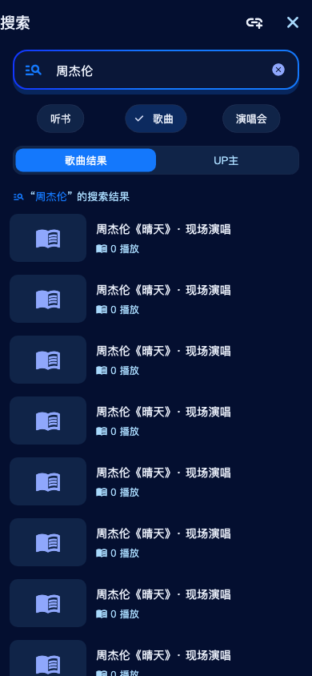
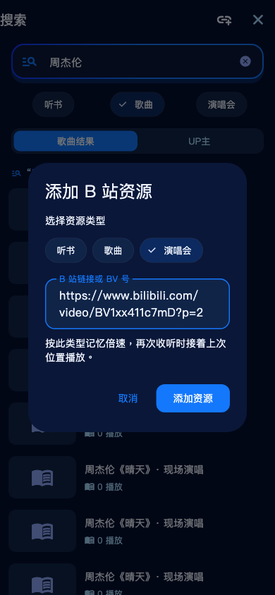

<div align="center">


# 阿B听书

**免登录、无广告、专注收听的第三方 B 站有声小说播放器**

Flutter · Android · 永久免费 · 开源

</div>

---

## 简介

阿B听书是一个基于 Flutter 的 Android 听书播放器：把 B 站当作有声书库，搜索、分类浏览有声小说、评书、相声、广播剧，点开即听。

- 🔓 **免登录**：不登录即可搜索、收听、收藏、记录进度；扫码登录仅用于同步昵称头像与提升搜索稳定性。
- 🚫 **无广告**：没有广告、没有会员、没有弹窗，打开就能听。
- 🎧 **专注收听**：分P连播、断点续播精确到秒、睡眠定时、后台播放与锁屏控制，为长时间听书优化。
- 📥 **真能离线**：选集批量缓存后后台下，通知栏看得见进度，中途退出也不丢、无网照听。

非官方项目，与哔哩哔哩无任何官方关联或背书；内容来自哔哩哔哩公开视频的音频轨道，应用本身不存储、不修改、不二次分发任何内容。

## 本地扩展：歌曲与演唱会第一版

当前开发分支在保留听书功能的基础上，增加三种收听模式，音频来源均为 B 站视频：

- **搜索**：发现页可进入歌曲、演唱会分类；搜索页可切换听书 / 歌曲 / 演唱会。听书沿用原筛选及补搜，歌曲和演唱会不套用听书的关键词及时长门槛。建议输入明确的歌名、歌手或“歌手 + 演唱会”，搜索结果仍可能包含不同版本及相关视频。
- **添加资源**：在发现页或搜索页点击“添加链接/BV”，选择类型并粘贴裸 BV、标准视频链接、B 站分享文本或 `b23.tv` 短链接。取得详情后加入收藏；无效链接、失效视频和不存在的分 P 会提示错误。链接明确指定 `p` 时，播放按钮指向该分 P。
- **独立倍速**：听书保留原来记住的倍速，歌曲、演唱会初始为 1.0 倍；之后的倍速选择按三种模式分别记忆。
- **续播**：听书和演唱会重新进入时恢复进度；歌曲重新选择时从头播放。主动选择分 P、暂停后恢复和断流重连保留其对应操作语义。
- **本地兼容**：旧书架、进度和缓存仍按听书读取；新资源的类型随收藏、离线缓存和待下载队列保存。歌曲、演唱会通过手动收藏管理。

本版不包含跨视频歌单、循环/随机播放或整场演唱会自动分曲。已分 P 的演唱会可按分 P 选择；单 P 的整场仍作为一个音源播放。这是本地源码改造，尚未发布为 GitHub Release。

开发验证命令：`flutter test`、`flutter analyze`。链接解析和网络请求使用受控测试响应验证；已完成一轮 Android 16 真机基础验证，实测范围、调试调用方式及待补测项目见 [Android 测试记录](docs/testing/2026-10-23-android-device.md)。

界面预览（Widget 实际渲染，使用测试数据，并非线上资源验证）：

 

## 功能特性

**发现与搜索**
- 分类浏览：热门推荐 / 广播剧 / 评书 / 相声 / 悬疑 / 玄幻仙侠 / 名著悦读
- 精选主播：单田芳、刘兰芳、郭德纲、周建龙、紫襟、王明军、光合积木、729声工场 等，一点直达 TA 的作品
- 搜索自动限定在「有声小说」范围，过滤解说、漫推、短视频等无关内容
- 搜索分「听书 / UP主」两个标签（搜索出结果后才出现，切换时先加载完再切换不闪屏）：UP主标签可搜主播、关注后进入 TA 的主页只看他的投稿内容
- 书籍详情页点 UP 主名可直达 TA 的主页
- 搜索结果上拉分页加载，失败会提示并可一键重试
- 分类结果本地缓存，减少重复请求

**播放**
- 分P 即章节：自动连播、上/下一章、±15 秒快进退
- **倍速播放**：0.5x / 0.75x / 1.0x / 1.25x / 1.5x / 1.75x / 2.0x / 2.25x / 2.5x / 2.75x / 3.0x 共 11 档预设，点一下即切换，自动记住上次的倍速
- **播完本集自动暂停**：本集播完即停，不自动连下一集（可一键开关）
- 断点续播精确到秒（退到后台、切换章节、退出应用都会保存进度）
- **断流自动重连**：长音频播放中断自动换备用线路重连并回到原位置，不再出现「莫名其妙停了」
- 章节列表：标题自带序号时不重复编号；**已听章节打 ✓ 并置灰**，支持正序/倒序
- 睡眠定时：预设 10/15/30/45/60 分钟、2 小时，也可自定义 1~720 分钟
- 音频焦点：来电或其它应用播放时自动暂停，打断结束后自动续播；**拔耳机自动暂停**；提示音只压低音量不打断
- 后台播放：前台服务 + 系统媒体会话，通知栏与锁屏可控制，暂停后通知不消失

**离线缓存**
- 详情页每集可单独缓存，播放页 / 详情页可勾选多集**批量缓存**
- **后台缓存**：开始后可立刻离开页面，回桌面、切页面都不中断下载
- **通知栏进度**：显示正在缓存的集名与百分比，全部完成后自动消失
- **断了能续**：App 被系统回收或你手动划掉重进，下次启动自动接着下完剩余队列
- **失败可见可重试**：某一集失败不会悄悄消失，会列出失败原因并支持一键重试
- 离线缓存管理（我的 → 离线缓存）：按书分组、查看已缓存章节、单个/批量删除、可直接播放
- 缓存文件按**作品原本的章节顺序**展示（不是按缓存先后）
- 缓存保存在应用内部私有目录，与索引同分区，覆盖升级不丢
- 下载前预估所需空间，空间不足会提前提示而不是下到一半失败

**其它**
- 书架收藏、继续收听、最近收听（均显示**整本书**的进度百分比）
- 书架右上角续播角标：显示上次在听那本的圆形封面，点一下续播；正在播放时角标随封面旋转，点一下直接回到播放页
- 书架点一下直接续播进播放页；播放页点书名回到书籍详情
- 我的页面统计（书架 / 在听 / 已缓存 / 关注）可点击直达对应页面
- 关注的 UP 主（我的 → 关注的 UP 主）
- 关于页：官网、开源仓库、Issue 反馈、协议与免责声明入口
- 扫码登录（二维码可保存到相册）
- 外观模式：跟随系统 / 浅色 / 深色
- 后台留存保护（电池优化豁免引导）
- 检查更新：一键比对 GitHub Releases，有新版本直接提示下载
- 分享原作品链接

## 更新日志

### v1.2.0

**新增**

- **书架右上角续播角标**：以「上次在听」那本的圆形封面做底、叠加播放图标，点一下直接续播；
  正在播放时角标换成当前播放封面并像唱片一样旋转（与底部悬浮条一致），此时点一下直接进播放页，不再重新加载
- **离线缓存体系**
  - 批量选集缓存，开始后可离开页面，下载在后台继续
  - 通知栏实时显示缓存集名与百分比
  - 未完成的队列落盘，App 被杀后重启自动续传
  - 失败集单独列出原因并支持一键重试（不再静默丢弃）
  - 缓存按作品原始章节顺序展示
- **离线与在线统一**：无论从哪进，目录、上下章、断点续播、进度保存都是同一套逻辑；
  没网时会自动退回已缓存的章节，发现页无网时会列出已缓存书籍
- **书架显示整本书的播放进度**（不再是某一章的百分比），并显示每章收听进度
- 倍速 0.5x~3.0x 共 11 档预设（去掉滑块，点一下即切）
- ±15 秒快进退、播完本集自动暂停、已听章节 ✓ 标记
- UP 主搜索 / 关注 / 投稿合集与上拉分页
- 关于页与启动加载页

**修复**

- **点开就退会丢进度**：刚起播时媒体时长还没解析出来，进度会被整条丢弃；现改用章节时长兜底
- 长音频断流自动重连，长书不再「莫名停止」
- B 站 412 风控阶梯退避与 buvid 预激活，游客态请求限速
- 缓存文件误删（两处）：迁移改「复制→校验大小→删源」，且文件完好时不再因为播放打开失败就删缓存
- 批量缓存「少一集」：B 站返回空音频地址被当成成功，现改为重试并把失败暴露给用户
- 缓存条目顺序错乱：原按缓存先后展示，现按作品章节顺序
- 空间预检按 16kbps 低估 8 倍导致下到一半失败，改为按真实码率估算
- 缓存「已失效」误报：同一文件被两处代码判断出相反结论，已合并为单一判断入口
- 通知栏与系统媒体状态漂移、来电打断恢复、拔耳机暂停
- 首页/搜索/我的多处交互与跳转问题

## 截图

| 书架（精确进度 / 继续收听） | 发现（分类 / 精选主播） | 我的（收藏 / 设置入口） |
| --- | --- | --- |
|  |  |  |
| 书籍详情（分P目录 / 已听置灰） | 播放（连播 / 睡眠定时入口） | 睡眠定时（自定义 1~720 分钟） |
|  |  |  |

## 下载

上游发布版可在 [Releases](../../releases) 查找。当前分支的歌曲 / 演唱会改造尚未发布正式包；下表说明四种构建的选择方式，实际大小及校验和以构建清单为准。最低系统为 Android 7.0（API 24）。

| 安装包 | 体积 | 适用设备 |
| --- | --- | --- |
| `abts-v1.2.0-arm64-v8a.apk` | 构建后实测 | 大多数现代安卓手机；ARM64 Android 模拟器 |
| `abts-v1.2.0-armeabi-v7a.apk` | 构建后实测 | 支持 32 位 ARM 应用且满足最低系统要求的设备 |
| `abts-v1.2.0-x86_64.apk` | 构建后实测 | Intel / AMD 电脑上的 x86_64 Android 模拟器及对应设备 |
| `abts-v1.2.0-universal.apk` | 构建后实测 | 同时包含上述三种 ABI，体积较大；不包含 32 位 x86 或 RISC-V |

> 用 `adb shell getprop ro.product.cpu.abilist` 查看设备支持的 ABI。Apple Silicon 上的 ARM64 模拟器应选 ARM64 包。覆盖升级还要求包名和签名一致、versionCode 不降低；自行签名的包通常不能覆盖原作者签名的版本。

## 从源码构建

Android 真机调试可先运行 `flutter run -d <设备ID>`，或用 `flutter build apk --debug --target-platform android-arm64` 生成 ARM64 手机的调试包。调试版名称为“阿B听书·测试”，包名为 `dev.pages.abts.debug`，可与原版并存，收藏、进度和缓存各自独立。发布版仍使用原包名。

电脑测试命令及覆盖范围见 [模拟器测试教程](docs/testing/android-desktop-guide.md) 与 [模拟器验收记录](docs/testing/2026-10-23-android-emulator.md)，实机验证见 [Android 测试记录](docs/testing/2026-10-23-android-device.md)。

```bash
# 当前 Intel Mac 已配置持久工具链
tool/test-android.sh               # 静态分析、单元/组件、模拟器、跨进程恢复
tool/test-android.sh online        # 单独验证真实 B 站联网搜索与播放
# 配置正式签名后再运行（本次不生成正式包）
tool/build-android-apks.sh
```

**签名说明**：四包脚本要求 `android/key.properties` 和正式证书，并核验产物签名；缺失即退出。直接使用原有 Gradle release 构建仍会在缺少配置时回退 debug 签名，不能将这种包作为正式发布包。四包脚本保留相同 versionCode；直接使用 Flutter 的 `--split-per-abi` 会产生不同版本号，不能据此承诺与通用包互相覆盖升级。配置格式：

```properties
storePassword=你的密码
keyPassword=你的密码
keyAlias=你的别名
# 相对 android/app/ 目录，或使用绝对路径
storeFile=abitingshu.keystore
```

## 项目结构

```
lib/
├── core/
│   ├── network/        # BiliClient（Cookie 预热 / WBI 签名 / 限速重试）、CookieJar、端点常量
│   ├── storage/        # 书架与进度、离线缓存（CacheStore：队列/对账/迁移）、关注、搜索历史
│   ├── theme/          # 主题与配色（跟随系统 / 浅色 / 深色）
│   └── nav/            # 底部 Tab 全局切换
├── data/               # 分类与精选主播种子数据
├── models/             # Book / Chapter / AudioTrack / UpUser
├── player/             # BookPlayer（连播、断点续播、睡眠定时、音频焦点）+ 系统媒体会话桥接
├── services/           # BiliApi 数据层、缓存通知桥、登录态、音频焦点、外链跳转、相册保存
├── pages/              # 书架 / 发现 / 搜索 / 详情 / 播放 / 离线缓存 / 我的 / 关于 / 登录 / 睡眠定时 …
└── widgets/            # 迷你播放条、书籍卡片、封面 …
android/app/src/main/kotlin/dev/pages/abts/MainActivity.kt   # 音频焦点、电池优化、保存图片、缓存通知等原生通道
tool/                  # 接口探针脚本（调试用，可独立 dart run）
```

## 免责声明

1. 本应用为第三方个人开发的播放工具，与哔哩哔哩官方无任何关联，不代表、也不受哔哩哔哩官方授权或认可。
2. 应用内所有音频、封面、文字等内容均来自第三方平台的公开链接，版权归原作者及相关权利人所有。本应用不存储、不修改、不二次分发任何内容。
3. 内容仅供个人学习、研究与试听交流使用，请勿用于任何商业用途；请勿下载、录制或传播相关内容。
4. 请在试听后支持正版：如喜欢某部作品，建议前往官方平台购买、订阅或支持作者。
5. 若权利人认为本应用侵犯其合法权益，请告知开发者，我们将在核实后及时处理（包括但不限于移除相关入口）。
6. 因使用本应用产生的任何直接或间接后果，由使用者自行承担。

## 开源协议

[MIT](LICENSE)

## 致谢

参考与借鉴了以下开源项目的思路：PiliPlus、biu、bbplayer、bili-music、BiliPai 等。
