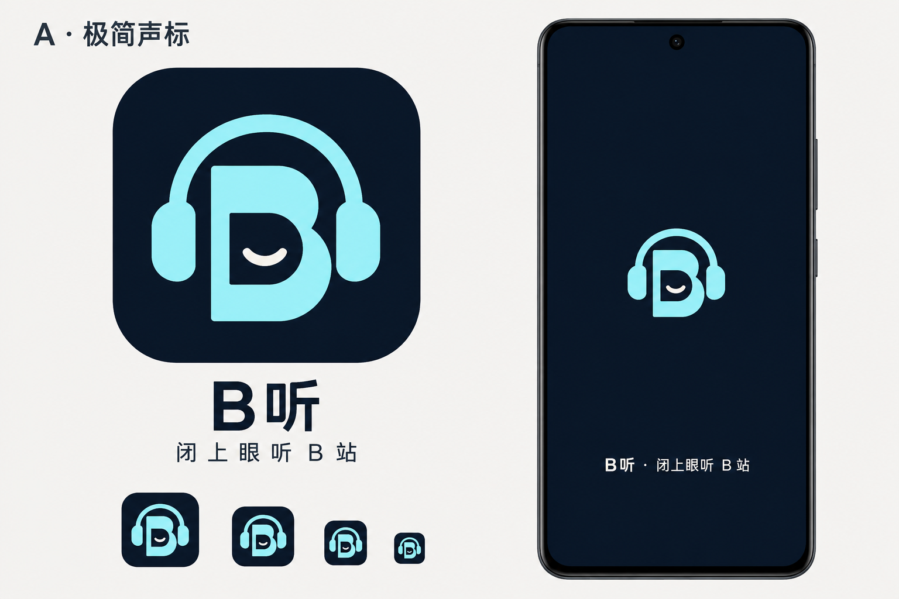
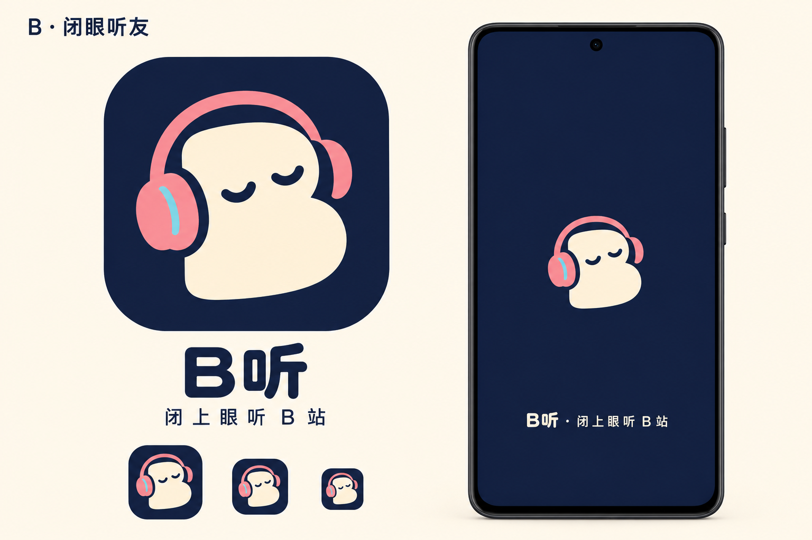
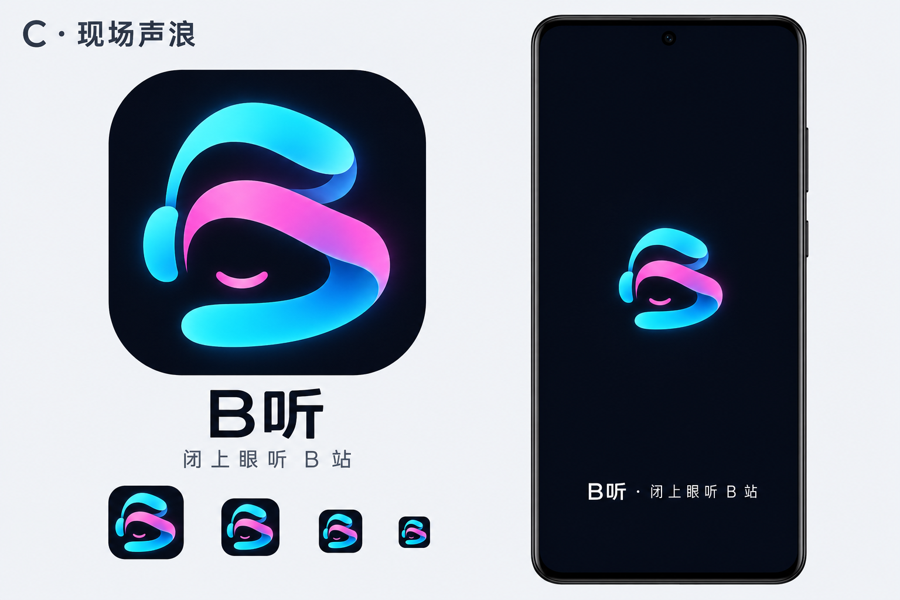

# B听视觉概念 · 已选 B「闭眼听友」

使用内置 imagegen 分别生成三张 1536×1024 概念板，展示图标、大/小尺寸识别效果与开屏。图中的手机是生成的设计示意，不是应用实测截图。完整提示词见 [prompts.md](prompts.md)。

| 方向 | 特征 | 适合的体验 |
| --- | --- | --- |
| A · 极简声标 | 深蓝、冰青、字母与耳机结合 | 简洁克制、工具感 |
| B · 闭眼听友 | 奶油白角色、珊瑚粉耳机、闭眼表情 | 亲和放松，兼顾听书与音乐 |
| C · 现场声浪 | 青粉声浪、流动轮廓、轻微发光 | 音乐和演唱会氛围 |

用户已选择 B「闭眼听友」，并在 2026-10-24 认可整体 UI 方向。A、C 保留为探索记录。正式图标、启动资源和主题色尚未替换。

后续开发遵循 [视觉与交互规范 v1.0](../bting-design-system-v1.md)。[B 风格 UI 提案](b-ui-direction.md)保留初始建议、配色和概念图；具体组件、状态和扩展规则以规范为准。

