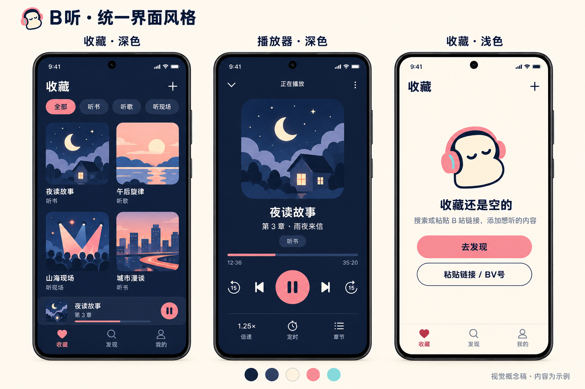

# B听 · B 风格 UI 提案

状态：用户已选择 B「闭眼听友」品牌方向，并在 2026-10-24 认可整体 UI 方向。本文保留最初设计建议；后续以 [视觉与交互规范 v1.0](../bting-design-system-v1.md) 为准。尚未实施到应用。

## 推荐范围

统一整个应用的视觉语言，同时保持已经确认的导航、功能与播放规则。仅更换图标会留下原有蓝紫按钮和新图标的风格差异；全面重排页面则超出本次品牌统一的需要。建议统一主题、控件、播放器和状态页面，在必要位置小幅改善操作层级。

现有主题位于 `lib/core/theme/app_theme.dart`，品牌主色为 `#1478FC`，包含蓝紫渐变；现有外观设置支持跟随系统、浅色、深色。应保留这三种设置，并提供一套匹配 B 方案的深浅色主题。

## 建议色板

下列色值是从 B 方案风格延展的建议值，并非对生成图逐像素取色的结果。

| 用途 | 建议颜色 | 使用方式 |
| --- | --- | --- |
| 深色背景 | `#152342` | 页面底色，保持安静的夜间氛围 |
| 深色卡片 | `#203252` | 与背景分层，避免重阴影 |
| 奶油白 | `#FFF4DE` | 深色正文、角色主色 |
| 珊瑚粉 | `#F58F9C` | 主播放按钮、进度、主要操作；按钮上用深蓝字或图标 |
| 薄荷青 | `#8BD8D8` | 少量辅助点缀，不与主操作争抢注意力 |
| 浅色背景 | `#FFF8ED` | 白天使用，搭配白色卡片与深蓝正文 |
| 浅色强调文字 | `#AC4157` | 小号选中标签等位置，避免浅粉字在浅底上难读 |

成功、警告和错误仍有独立语义；错误不能仅靠粉色区分。选中状态同时依靠文字、图标形态或背景，而非仅靠颜色。

## 页面与组件

- 图标、Android 启动页与应用内开屏使用同一套角色和配色；不人为增加开屏等待时间。
- 收藏、发现、我的统一圆角、间距、标题层级、图标笔画和选中态。现有三个底部导航及听书 / 听歌 / 听现场入口保留。
- 播放器用珊瑚粉强调播放与进度；内容封面保留资源本身的图片，背景遮罩保证文字清晰。定时、倍速、章节入口保持易找。
- 常驻迷你播放条与主播放器使用相同的播放、暂停、加载状态和颜色。
- 搜索、链接 / BV 号导入、弹窗、缓存列表、设置页同步主题，避免遗漏硬编码蓝紫色。
- 闭眼角色用于开屏、空收藏、空搜索等有明确作用的位置；正文使用系统字体，角色不占用正常列表的大块空间。

## UX 建议

- 保留默认跟随系统；深色和浅色都应完整可用。
- 主播放操作容易点击，文字放大后不遮挡按钮与进度；加载、空内容、失败都给出明确下一步。
- 空收藏提供“去发现”和“粘贴链接 / BV号”两个入口，复用已有搜索和导入能力；已纳入规范的待实施清单。
- 听书 / 听现场恢复播放进度、听歌重新选择时从头播放，以及暂停后继续播放的规则保持不变。
- 减少装饰动效，避免整页持续闪烁；不作未经测量的省电或护眼承诺。

## 概念图边界

使用内置 imagegen，以已选 B 概念图为风格参考，展示深色收藏、深色播放器和浅色空收藏。图内的内容名称、封面、进度均为示例，不是实测截图。卡片列数及控件位置用于表达视觉层级，具体布局应按实际屏幕和现有页面校准；图中出现的排列不代表功能已经实现。

完整生成提示词见 [b-ui-prompt.md](b-ui-prompt.md)。本轮仅保存设计提案和 B 方向选择，不修改应用代码或运行测试。

## 落地验收建议

完成视觉实施后，在专用模拟器检查深浅主题、启动页、收藏/发现/我的、播放器、搜索导入、空态与错误态；检查小屏和放大字体、按钮对比与点击区域，并运行现有自动化回归，确认播放与数据行为未受影响。本次仅形成提案，不报告为已实施或已通过上述验收。
