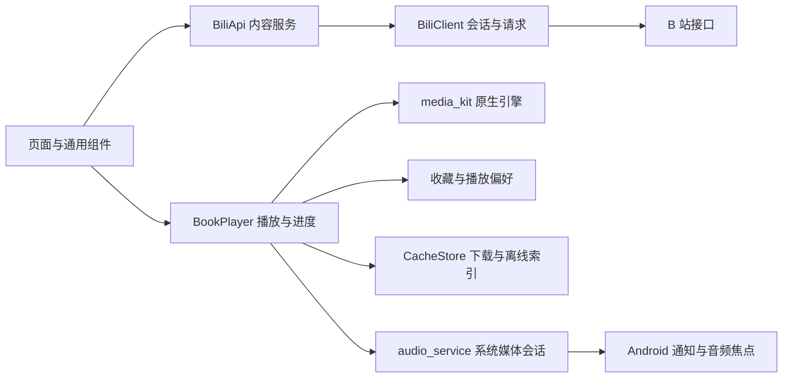

# B听（Blisten）全项目审查与改进建议

日期：2026-10-24。审查基线：`273df4a`（`codex/bting-design-v1`）。本次只新增审查材料和独立诊断用例，未修改生产代码、发布安装包或操作手机。

## 先看结论

**B听已经具备继续内部试用的基础，但应先修隐私、播放意图和进度保存问题，再进入正式发布。** 不需要推倒重写；最有价值的下一步是补好现有功能的边界。

已有优势是三模式规则明确、视觉基线统一、来源致谢完整、链接导入有白名单、原生播放和电脑自动化测试已经建立。问题主要集中在：连续播放与停止时的数据保存、异步请求晚返回、真实 API 与页面错误状态之间的断层，以及二级弹层和较老 Android 的兼容性。

本轮重新运行的常规测试全部通过，真实 B 站搜索与在线播放也通过；另外针对源码疑点新增 **17 个探针，全部复现了正确预期与实际行为的偏差，归为 11 个问题组**。同一问题可能有多个探针，例如睡眠面板的四种屏幕/字号组合，不能把 17 次失败当作 17 个独立 Bug，更不能据此计算整体缺陷率。

建议阅读顺序：本页结论与优先级 → [分阶段改进方案](../../superpowers/plans/2026-10-24-quality-improvement.md) → 需要技术细节时查看[复现用例说明](probes/README.md)和[证据摘要](evidence.json)。

## 1. 审查范围与证据等级

覆盖全部 57 个 `lib/` Dart 文件的职责与主要路径，以及 Android 原生入口、manifest、构建配置、依赖锁定、CI、打包脚本、现有测试和设计文档。播放/数据、产品/交互、API/安全分别独立审查，主任务执行测试并合并去重。这里的“全面”是检查维度完整，不代表所有设备、所有资源与无限使用时长均已验证。

| 证据等级 | 含义 |
| --- | --- |
| 实测复现 | 以真实代码执行可重复用例，断言实际行为偏离正确预期 |
| 源码确认 | 调用路径或平台 API 契约明确，但本轮未在对应设备/操作组合上实跑 |
| 待专项验证 | 有风险线索，需要网络、读屏、设备或长时间测量；不计为已证实 Bug |
| 产品增强 | 当前没有承诺的新能力，不属于现有功能缺陷 |

优先级：**P1** 应先修，涉及账号信息、核心播放/数据或已承诺最低系统的崩溃风险；**P2** 下一批完成，影响功能正确性与恢复体验；**P3** 一致性打磨。未做安全认证，不声称已发生真实账号泄露。

## 2. 本轮实际测试

环境：Intel Mac、Flutter 3.38.10 / Dart 3.10.9、JDK 17；专用 Android 15 / API 35 x86_64 模拟器，720×1280、320dpi。构建产物实际最低 API 24、target/compile API 36。没有使用实体手机或真实登录凭据。

| 检查 | 本轮结果 | 可以说明什么 |
| --- | --- | --- |
| `tool/test-android.sh all` | 退出 0 | 静态分析无问题；102 单元/组件通过、1 条件截图用例跳过；10 打包检查通过；26 Android 场景通过 |
| `tool/test-android.sh online` | 退出 0 | 真实听书/歌曲/现场搜索分别得到 16/20/20 条结果，公开资源原生在线播放进度 3052ms；只代表本次冒烟 |
| API 探针 | 6 个预期行为断言失败 | 错误吞并、登录状态、退出竞争、凭据日志、并发限流问题 |
| UX 探针 | 6 个预期行为断言失败 | 详情假成功提示；睡眠面板四种尺寸/字号溢出；10 分钟出现五个选中项 |
| 原生播放探针 | 5 个预期行为断言失败 | 连续进度保存、加载中暂停、误判下架、离线分段恢复、停止归零 |
| 单元/组件覆盖率运行 | 102 通过、1 跳过 | 生成 LCOV，作为定位缺口的辅助数据 |
| 新审查用例加入后的静态分析 | 通过 | 用例保存在 `docs/`，两份组件测试仅局部声明测试专用 API，未放宽生产分析规则 |
| Android 原生 lint | 退出 1，1 error / 11 warnings | 确认 API26 通知构造与 min24 不兼容；警告需分类处理，不能一概算 Bug |
| APK 静态结构 | ZIP 16KiB 对齐通过；9 个 64 位库 LOAD 对齐均不低于 16KiB | 当前 debug 测试入口包的静态检查；不等于正式四包或 16KiB 设备运行通过 |

常规全套日志：`build/desktop-tests/20261024-104853-73498/`。联网日志：`build/desktop-tests/20261024-105411-73496/`。新增探针、覆盖率和原生 lint 日志在 `build/review-20261024/`。原始日志不入 Git；证据摘要只保留脱敏结果与哈希。

**覆盖率的正确读法：** 单元/组件 LCOV 记录 52 个文件，3284/6249 条被统计语句行被执行，约 **52.55%**。这不包含 Kotlin、Android 集成测试覆盖，也未包含 5 个未被这次单元测试加载的文件。`BookPlayer` 的单元覆盖为 0，但已有真实原生集成测试，不能据此说播放器“完全没测试”。实际缺口在行为组合：原重启测试先暂停，因而没有发现持续播放不保存；页面测试替换整个 API，因而没有发现真实 API 内部吞错。

### 原生 lint 的补充发现

两次离线尝试先被本机缺少检测依赖阻塞；明确 x86_64 目标并让 Gradle 补齐已有版本依赖后，完整 lint 确实执行，结果为 **1 个错误、11 个警告**。应用依赖版本未升级。

- 1 个 `NewApi` 是 R04 的确定兼容性问题，应修复，不应建立 baseline 隐藏。
- 1 个 `BatteryLife` 提醒直接申请忽略电池优化的分发政策风险。若后续上应用商店，应按实际渠道和核心功能核查；不凭这条静态警告宣称已经违反平台政策。[Android 电池优化规则](https://developer.android.com/training/monitoring-device-state/doze-standby)
- 1 个 `ExportedService` 指向媒体浏览服务。该导出配置也是 audio_service 的标准集成方式，不能直接改成不导出而破坏系统媒体连接；应审查客户端访问与数据边界，当前没有已利用漏洞证据。[audio_service 配置](https://pub.dev/packages/audio_service)
- 5 个 `IconLauncherShape` 关注旧式图标外缘，需在旧启动器实看；现代自适应图标裁切已有实测，不把五个密度重复警告算五个功能问题。
- 其余 4 个是两处多余版本分支/资源和两处 KTX 写法建议，属于低优先级维护，不进入核心修复范围。

## 3. 优先问题清单

以下位置均以审查基线为准。括号内 R 编号用于与改进方案、证据对应。

| 编号 / 优先级 | 用户会遇到什么 | 证据 | 处理方向 |
| --- | --- | --- | --- |
| R01 / **P1** | 登录后的预热日志可能包含完整登录凭据 | 实测：假会话值原样进入日志 | 删除凭据值日志，统一脱敏，核查 release 日志 |
| R02 / **P1** | 连续收听没有定期保存；停止后已有断点被写成 0 | 实测：播放超过 6 秒仍存 0；20 秒断点在 stop 后变 0 | 真正定期保存；停止前保存并隔离位置重置事件 |
| R03 / **P1** | 网络加载期间按了暂停，稍后仍自动播放 | 实测：阻塞音源→暂停→放行后仍 playing=true | 让最新暂停意图约束所有异步起播路径 |
| R04 / **P1** | Android 7/7.1 缓存通知调用了 Android 8 才提供的构造函数 | 原生 lint＋官方 API 确认；未跑 API 24/25 | 按系统版本构造通知；补最低版本实际测试；同时补旧系统二维码存储权限 |
| R05 / P2 | 仅缓存第 3 段后恢复联网，续播跳到第 1 段 | 实测：CID 503 变为 501 | 用稳定 CID 恢复，索引仅作回退，区分完整/局部目录 |
| R06 / P2 | 音频服务器暂时失败，却提示“作品已下架”并引导删除收藏 | 实测：有效目录＋媒体 503 返回 bookGone | 区分资源不存在与音源/网络失败，保留进度和重试 |
| R07 / P2 | 首页或 UP 投稿加载失败，被显示成“没有内容” | 实测：真实 API 门面在全部来源失败后仍返回空列表 | 空成功、部分成功、全失败分别传递，保持同页可重试 |
| R08 / P2 | 登录已失效仍显示登录；退出后旧响应又恢复账号展示 | 两个实测探针复现 | 以服务端明确结果为准；为身份会话增加代次 |
| R09 / P2 | 同时发请求时限流失效，失败重试还可能层层叠加 | 间隔实测出现 0ms；重试叠加仅源码风险 | 预约发送时隙；统一总超时、重试和取消预算 |
| R10 / P2 | 打开睡眠定时后选项超出面板 | 实测：100% 字体溢出 48px，200% 溢出 285px | 弹层可滚动、限制高度并覆盖全部选项可达性 |
| R11 / P2 | 设置 10 分钟时，五个时长同时显示选中 | 实测 | 分离选定预设与剩余时间，两个定时入口共用规则 |
| R12 / P2 | 点详情章节播放失败，仍提示“正在播放” | 实测 | 根据实际结果显示加载、成功或可恢复错误 |
| R13 / P2 | 从关注列表重访歌手，歌曲被当成听书处理 | 源码确认 | UP 页显式选择/保留模式，兼容旧关注数据 |
| R14 / P2 | 关闭缓存面板后晚返回仍导航；连续点击详情会重复打开播放器 | 源码确认 | 防重复提交；只操作当前仍有效的请求与路由 |
| R15 / P2 | 清空缓存时下载队列仍运行，清完又出现文件或任务失败 | 源码确认 | 先取消并等待写入结束，再清索引/文件/持久队列 |
| R16 / P2 | 凭据与音频没有明确的系统备份排除规则 | 合并 manifest 确认；未执行云备份 | 明确备份政策，分离凭据，排除凭据与大音频 |
| R17 / P2 | 播放先开始，再请求音频焦点，且忽略拒绝/延迟 | 源码与平台规则确认；电话/竞争播放器未实跑 | 获准后播放；延迟等回调；拒绝保留暂停；绑定媒体服务生命周期 |
| R18 / P2 | 搜索 UP 主只显示首 20 条，不能继续翻页 | 源码确认 | 补分页、失败重试和旧请求隔离，或明确显示限制 |
| R19 / P2 | 部分真实页面缺少读屏操作名称或选中语义 | 源码确认；完整 TalkBack 未验收 | 补清空搜索、倍速、章节的名称/状态及焦点规则 |
| R20 / P3 | 后台保护状态更新滞后、自定义定时错误会关闭输入、最近收听说明不准确 | 源码确认 | 返回前台重查权限；表单内校验；文案明确实际范围 |

### 3.1 关键证据与修复边界

**R01：账号信息保护。** [bili_client.dart:129](../../../lib/core/network/bili_client.dart#L129) 直接打印 `_jar.buildHeader()`。本轮用纯合成 Cookie 复现，没有读取真实用户 Cookie。`debugPrint` 在 release 中仍输出，不能把“调试打印”当作不泄露的保证；[cache_store.dart:216](../../../lib/core/storage/cache_store.dart#L216) 和 272 附近相反的注释也应更正。最小修复是任何模式都不输出凭据值；日志只记录操作和错误类型。[Flutter 官方说明](https://api.flutter.dev/flutter/rendering/debugPrint.html)

**R02–R03：播放生命周期。** [book_player.dart:1422](../../../lib/player/book_player.dart#L1422) 每个位置事件重设 2 秒计时器，导致一直播放就一直推迟保存。[stop:1168](../../../lib/player/book_player.dart#L1168) 未先保存稳定位置、未取消实际保存计时器，而原生停止产生的位置 0 会被写回。[pause:1140](../../../lib/player/book_player.dart#L1140) 没有改变加载完成后的起播意图。应保留当前模式规则，完善“想播放/想暂停”和“当前资源/请求”的边界；不需要换播放器。

**R04：最低系统承诺。** [MainActivity.kt:298](../../../android/app/src/main/kotlin/com/bting/audio/MainActivity.kt#L298) 无条件调用 `Notification.Builder(context, channelId)`，官方标记为 API 26 新增。最低 API 24/25 没有该构造函数，外围 `catch(Exception)` 不能兜住 `NoSuchMethodError`。本轮原生 lint 也以 `NewApi` 错误确认这一点；仍不称已在 Android 7 上重现崩溃。另 [GalleryService:26](../../../lib/services/gallery_service.dart#L26) 在 Android 9 及以下要求 storage 权限，但主/合并 manifest 没声明 `WRITE_EXTERNAL_STORAGE`，二维码保存路径需同时修正并限制到需要的旧版本。[Android 构造函数文档](https://developer.android.com/reference/android/app/Notification.Builder)

**R05–R06：恢复位置与错误分类。** [book_player.dart:625](../../../lib/player/book_player.dart#L625)、649 和 1442 附近把缓存子集的索引当全目录索引使用，虽然已经保存 `lastCid`。探针对内存中的记录按存储格式做了 JSON 序列化往返，并切换播放会话；**未重新读取磁盘，也未跨进程**。同文件 683–689 的 `bookGone` 判断只依据拿到目录而加载失败；[shelf_common.dart:145](../../../lib/widgets/shelf_common.dart#L145) 会据此给出下架删除提示。

**R07–R09：真实网络层。** [bili_api.dart:212](../../../lib/services/bili_api.dart#L212) 和 353–404 将全部请求失败折叠为空成功；[auth_store.dart:58](../../../lib/services/auth_store.dart#L58) 将本地 Cookie 存在视为有效登录，55–74 缺少会话代次；[bili_client.dart:197](../../../lib/core/network/bili_client.dart#L197) 的并发等待无法保证间隔。前两个探针调用真实 `BiliApi` 门面并注入始终抛错的客户端；其余四个调用真实客户端，将 HTTP 重定向到本机受控服务。并发间隔已实测，重试叠加仍是源码风险，尚未测量极端总次数和耗时。旧 nav 响应复活的是 UI/本地账号展示，**没有据此宣称已恢复有效 Cookie**；旧 `Set-Cookie` 响应需要另做测试。

**R10–R12：页面真实结果。** [player_page.dart:683](../../../lib/pages/player_page.dart#L683) 的默认限高弹层装入不可滚动 Column；724 的选中判断把“剩余时间小于等于选项”当相等。[book_detail_page.dart:624](../../../lib/pages/book_detail_page.dart#L624) 忽略 `playBook` 返回值，随后无条件展示正在播放。新探针覆盖的是实际页面，而不只是人工组合的通用按钮。

**R13–R15：跨页面与缓存操作。** [follow_page.dart:92](../../../lib/pages/follow_page.dart#L92) 不传模式，而 [up_home_page.dart:23](../../../lib/pages/up_home_page.dart#L23) 默认为听书；[cache_page.dart:633](../../../lib/pages/cache_page.dart#L633) 在 await 后无路由有效性检查便 pop/push；[book_detail_page.dart:547](../../../lib/pages/book_detail_page.dart#L547) 每次完成都 push。[cache_store.dart:1241](../../../lib/core/storage/cache_store.dart#L1241) 的 `clearAll` 不取消活动/排队/持久化待下载任务。这三组尚需专门的动态回归用例。

**R16：系统备份。** 完整 Cookie 保存在普通 SharedPreferences，主与合并 manifest 都未配置 `allowBackup`、`fullBackupContent`、`dataExtractionRules`。Android 默认备份范围可能包括偏好和应用文件，是否发生取决于用户/系统条件；本轮没有做真实云备份，也没有证明数据已上传。建议保留收藏/设置可恢复能力，显式排除凭据与大音频，并同步[关于页:286](../../../lib/pages/about_page.dart#L286)的说明。[Android 官方备份规则](https://developer.android.com/identity/data/autobackup)

**R17：音频焦点。** [book_player.dart:869](../../../lib/player/book_player.dart#L869)、894、1134–1136 先播放再异步请求焦点，结果被忽略；[MainActivity.kt:254](../../../android/app/src/main/kotlin/com/bting/audio/MainActivity.kt#L254) 将 DELAYED 当成功。平台明确要求焦点获准后才播放，延迟时应等待回调。Activity 销毁时还会注销耳机断开接收器，媒体服务继续存活的组合需实测。[Android 音频焦点规则](https://developer.android.com/media/optimize/audio-focus)

**R18–R20：可达性和状态一致。** [search_page.dart:230](../../../lib/pages/search_page.dart#L230) 禁止 UP 标签加载下一页；382 的清空按钮缺少可读名称。[player_page.dart:589](../../../lib/pages/player_page.dart#L589) 的倍速选择缺少选中语义。[settings_page.dart:38](../../../lib/pages/settings_page.dart#L38) 用固定 1.2 秒替代返回前台时重查；[sleep_timer_page.dart:158](../../../lib/pages/sleep_timer_page.dart#L158) 输入超界先关弹窗；[recent_page.dart:27](../../../lib/pages/recent_page.dart#L27) 没说明最近记录只展示有进度的收藏。完整历史未承诺，不将缺少它算作 Bug。

## 4. 各方面成熟度与后续重点

| 方面 | 已有基础 | 主要改进 |
| --- | --- | --- |
| 功能与内容 | 三模式、搜索、链接/BV导入、分 P、缓存、定时 | 先修规则在关注/缓存等入口丢失，再评估新功能 |
| 播放与后台 | 真实原生引擎、媒体会话、请求代次、离线回退 | 播放意图、数据保存、焦点、熄屏/打断/耳机专项 |
| 数据可靠性 | 私有缓存目录、临时文件后改名、已有迁移逻辑 | 保存原子性、清空与队列协作、按 CID 恢复、备份政策 |
| UI / UX | 已选品牌、深浅主题、空态/重试、小屏主页面 | 二级弹层、导航竞争、真实失败反馈、类型可见性 |
| 无障碍 | 大字、主要触控尺寸、语义测试基础 | 真实完整流程读屏、选择状态、错误播报与焦点恢复 |
| 网络 | TLS、域名白名单、分层 API、退避策略 | 总失败不伪装空结果、并发限流、取消与总耗时预算 |
| 隐私与安全 | 无统计 SDK、CDN 请求不带完整账号 Cookie | 删除凭据日志、会话隔离、凭据存储与系统备份排除 |
| 架构 | Provider、服务/模型/存储分层，适合当前体量 | 围绕真实问题抽出小职责，不全面重写 |
| 性能与功耗 | 位置 ValueNotifier、图片缓存、网络不阻塞首屏 | 尚无可信基准；需 profile/实机测启动、流量、内存、耗电 |
| 兼容性 | Android 15 x86_64 实测；最低声明 Android 7 | 补最低版本、ARM64、通知权限版本、16KiB和厂商后台策略 |
| 测试与维护 | 固定版本、本地 HTTPS、原生/恢复测试、CI 快速检查 | API真实门面、用户连续操作、失败组合、原生 lint与设备矩阵 |
| 发布与支持 | 来源/MIT、独立包名、正式打包守卫、校验清单 | 签名备份、真实四包安装升级、远程CI、反馈/更新与诊断脱敏 |
| Windows | 源码及同源图标保留 | 本轮未构建或运行，暂按实验性保留，不列入已支持平台 |

## 5. 架构：保留主干，修清边界

当前大文件：`BookPlayer` 1479 行、`CacheStore` 1258 行、搜索页 934 行、详情页 807 行、播放页 785 行。文件大本身不是 Bug；与本轮缺陷直接相关的是一个对象同时负责网络加载、播放意图、恢复位置、存储和系统回调，容易遗漏交叉状态。

推荐按修复顺序隔离三个小边界：**播放会话与意图、进度保存、缓存任务生命周期**。网络层补 **会话代次、可取消请求、统一错误与预算**。继续使用现有 Provider、media_kit 和 SharedPreferences，不因这次审查立刻换框架/数据库；当收藏规模、查询或迁移要求确实超过现有存储能力时再评估。

## 6. 待专项验证的风险

这些不是本轮已复现缺陷，不能用“所有测试通过”覆盖过去。

- **缓存完整性与恢复：** 目前主要验证文件非空，未证明 HTTP 200 错误页、截断但非空媒体能被识别；`load()` 不等待对账，可能与恢复下载竞争。后续用受控坏文件、慢磁盘和磁盘满场景验证。
- **删除当前播放项：** 删除进度后继续播放可能重新产生最近记录。需先明确“移出收藏但继续听”和“同时清记录并停止”的产品语义，再统一文案与实现。
- **长时间后台：** 30–60 分钟熄屏、切网络、来电、蓝牙断开、移除最近任务、系统回收、睡眠定时到期。模拟器不代表小米/OPPO 等实际后台策略。
- **真实性能：** 当前 debug＋软件渲染模拟器的耗时不能作为用户手机性能。建议在 profile/正式候选包测冷启动、首声延迟、滚动卡顿、30分钟内存变化、每小时流量/耗电；先采基线，不先写“省电多少”。
- **16KiB：** 本轮检查 13 个原生库，9 个为 64 位；LOAD 和 ZIP 对齐满足静态条件。部分 RELRO 末端非整齐 16KiB，但向上取整区间没有覆盖额外可写 LOAD，不据此判定不兼容。正式产物仍需重新检查并在 16KiB 设备运行。[Android 验证方法](https://developer.android.com/guide/practices/page-sizes)
- **账号与备份：** 未使用真实账号完成扫码、过期、换号与备份恢复；探针使用假会话和本机响应。旧 Set-Cookie、扫码取消后迟到响应要补测。
- **依赖：** 依赖与 CI Flutter 版本已锁定，但本轮未完成全量漏洞数据库/SBOM/全部传递许可证审计。不能把“未发现关闭 TLS”或“通过构建”当作无漏洞证明。

## 7. 后续新功能怎么选

建议优先解决“找回内容和控制播放”，再做“增加内容组织能力”。以下均是产品增强，不计入上述缺陷数量。

| 候选功能 | 用户价值 | 前置条件 / 建议 |
| --- | --- | --- |
| 收藏类型标签、类型修正入口 | 看清作品按哪种规则播放，修正误分类 | 先修 R13；分类变更时说明倍速/续播变化，不擅自重置记录 |
| 缓存任务管理、重试/取消/重新缓存 | 清楚知道下载到哪里、失败怎样处理 | 先修 R15 与完整性规则 |
| 章节书签与演唱会时间点 | 长书与整场演唱会更容易回到喜欢片段 | 稳定 CID＋偏移保存完成后做，不承诺自动分曲 |
| 本地歌单、顺序/单曲循环/随机 | 更符合听歌场景 | 单独定义跨视频队列、手动/自动切歌、不同模式混排策略 |
| 收藏/设置导出导入 | 换机、误删后可恢复 | 导出不含 Cookie 和音频文件；版本化、冲突策略、异常文件校验 |
| 更完整的最近收听 | 未收藏歌曲也容易找回 | 先确定保留数量、清除方式和隐私说明 |

本阶段不建议增加账号云同步、自建内容后台、复杂推荐系统或歌词服务；它们会明显扩大维护和数据范围，不能解决当前核心可靠性问题。

## 8. 正式发布前的最低门槛

1. R01–R04 清零，并把复现用例迁入常规回归，不能修改断言来让测试通过。
2. 完成 R05–R17 中影响实际收听、退出、错误恢复和数据清理的修复；剩余问题有明确处置与说明。
3. 原有回归、真实联网、关键边界、原生 lint、最低 Android 与 ARM64 真机/对应设备矩阵通过；完整读屏与后台专项按支持范围验收。
4. 用正式签名构建四包，核对 ABI、版本、证书、16KiB条件、安装/覆盖升级和数据保留；备份签名与恢复步骤。此轮没有生成正式签名包。
5. 建立项目实际反馈/更新入口，远程 CI 真跑一次；保留原项目致谢、MIT与所用第三方组件许可证，隐私说明与实际行为一致。

执行细节和每批的验收标准见[改进方案](../../superpowers/plans/2026-10-24-quality-improvement.md)。
