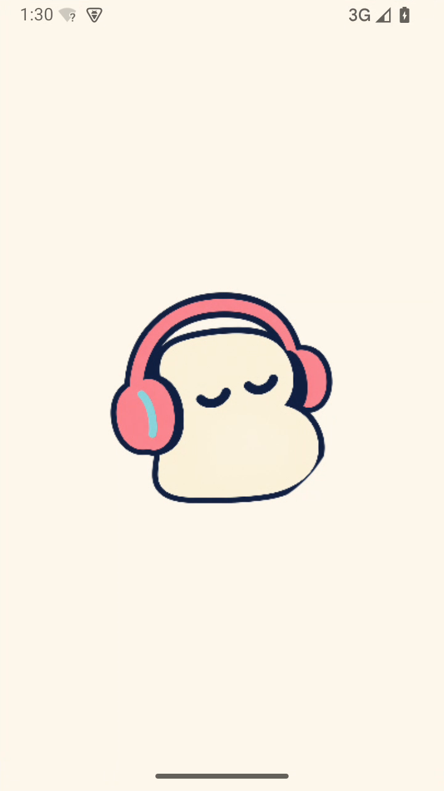
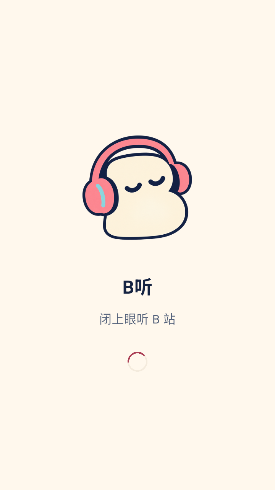
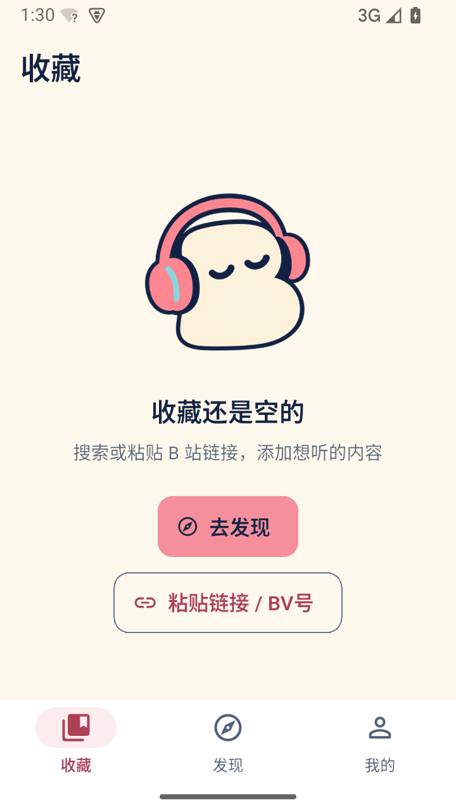
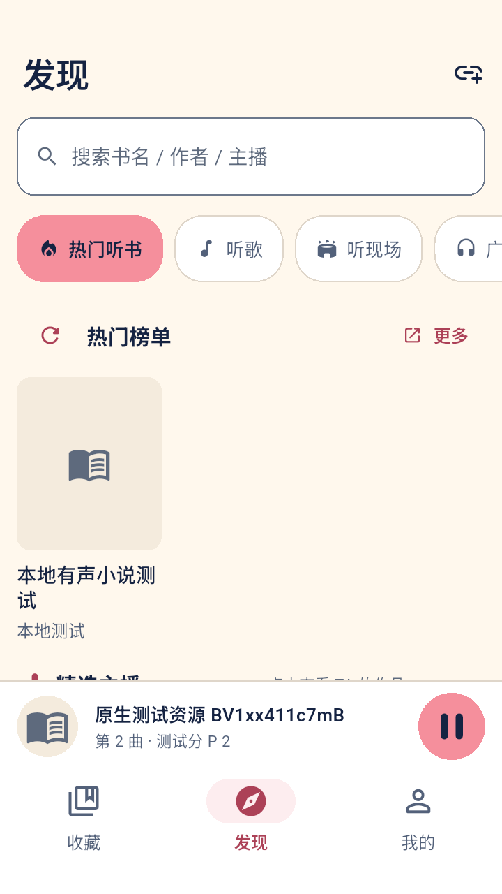
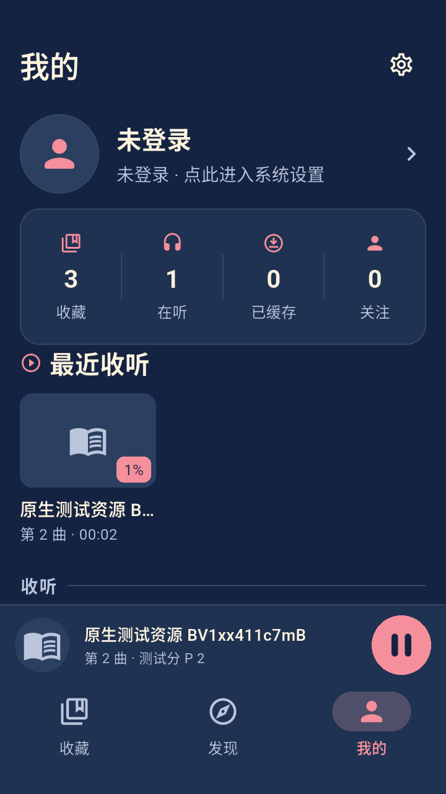
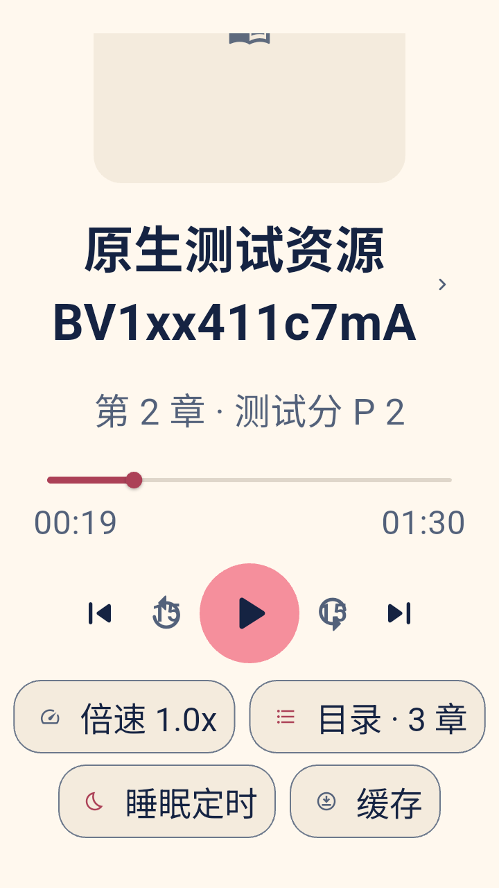
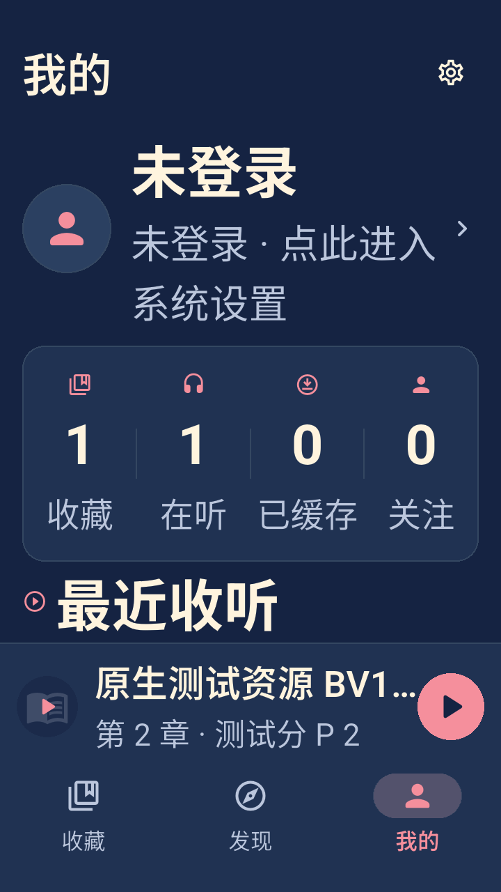

# B听视觉与交互 v1 实施验收

日期：2026-10-24。项目：Blisten；分支：`codex/bting-design-v1`。

本轮落实已选 B「闭眼听友」方案：正式角色与图标、Android 启动、深浅主题、现有页面及可恢复交互。来源致谢、包名、版本、存储键和三种模式的倍速/续播约定保留。

## 已实现

- 品牌：通过 imagegen 生成透明角色与方形图标，保留[母版及提示词](../design/bting-v1/production/README.md)；打包 Flutter、Android 各密度及 Windows ICO 资源。
- 主题：深蓝 / 奶油白背景、珊瑚粉主操作；单独设置浅色可点击文字、按钮前景、边界与错误色。覆盖收藏、发现、我的、详情、播放器、搜索/导入、登录、缓存、定时及设置等现有页面。
- 可用性：空收藏直接导入；详情移出收藏确认进度影响；发现失败不误称断网；UP 分页保留内容并重试；登录轮询失败可恢复；搜索历史删除有 48dp 触控区及说明，分类/结果标签提供选中语义。
- 播放：失败后可重试同一分 P / 偏移；过期地址重新解析；旧目录、旧重连和旧 fallback 不能覆盖新选择或停止；新选择失败不恢复成另一个未成功的候选资源；原生媒体错误由当前加载链处理。
- 布局：修正小屏、大字体、键盘遮挡及卡片元数据溢出；开屏/空态居中；主播放 72dp，其余控件按规范统一。减少动效时取消非必要旋转。

## 环境和最终结果

Intel Mac / macOS 13.7.8；Flutter 3.38.10 / Dart 3.10.9；JDK 17；Android Emulator 36.5.11；Android 15 API 35 x86_64，720×1280、320dpi（360dp 宽）。组件测试另覆盖 320×640dp、200% 字体。只操作专用模拟器。

最终执行：`tool/test-android.sh all`。日志目录和脱敏摘要见 [evidence.json](bting-design-evidence.json)。

| 检查 | 结果 | 说明 |
| --- | --- | --- |
| 静态分析 | 通过 | 无问题 |
| 单元 / 组件 | 102 通过，1 跳过 | 跳过的是已有的按环境变量启用的截图导出用例；新的原生截图套件单独执行 |
| Python 打包核验 | 10 通过 | 身份、ABI、证书/元数据等脚本规则 |
| 原有 Android 播放与缓存 | 5 通过 | 真实 native 解码、倍速、分 P、缓存、媒体处理器、搜索/导入 |
| 播放竞争和重试 | 15 通过 | 15 个场景，含真实原生 503 失败与恢复 |
| 跨进程恢复 | 2 通过 | seed / verify 各一个进程，验证三模式倍率和断点 |
| Android 视觉与导航 | 4 通过 | 4 个场景；深浅主题、200% 字体、返回继续播放、主题切换保持会话 |
| 拒绝通知权限 | 通过 | 在最后视觉播放套件中实际撤销并固定拒绝；运行结束恢复权限 |
| 正常入口构建、冷启动、桌面图标 | 通过 | debug APK 冷启动进入主页面；系统圆形遮罩未截断角色 |
| TalkBack 基础冒烟 | 通过 | 服务实际绑定，滑动后焦点框移动到“收藏”标题；恢复原模拟器辅助设置 |

界面截图来自真实 Android 渲染，示例资源由本地测试服务生成，封面为空时显示统一占位。截图捕获成功后人工逐张检查代表性页面；本轮没有宣称像素级 golden 对比。

## 实测画面

本次自动生成 **24 张**深浅主题与大字截图，另保存正常入口、Android 系统启动、桌面图标和 TalkBack 基础焦点证据。全部文件位于 [bting-v1 截图目录](../screenshots/bting-v1/)，哈希见证据摘要。以下均为程序实际渲染。

**启动和收藏**

  

**导入、发现与播放**

  

**我的与 200% 大字**

  

正常入口另以 `flutter build apk --debug --target-platform android-x64 --target lib/main.dart --no-pub` 构建、安装并冷启动，`am start -W` 返回 `Status: ok`。截图中的系统启动来自最终高清资源；调试构建和软件渲染环境的启动时间不作为性能基准。

## 回归如何防止再次出现

- `test/ux_feedback_test.dart`：中性错误、原列表保留、分页和二维码轮询重试、关注空态及输入保留。
- `test/player_ux_test.dart`：详情移出取消保留真实收藏/进度、确认后删除、失败重试入口和播放页/详情大字布局。
- `test/theme_accessibility_test.dart`：实际 Material / 文字渲染色对、Flutter 可访问性指南断言、320dp / 200% 各工具页操作可达。
- `test/feedback_layout_test.dart`：搜索键盘、发现/登录的大字状态、选择语义、历史删除触控和防误触。
- `test/visual_layout_test.dart`：空收藏导入、取消保留、大小字布局、元数据换行、品牌内容居中。
- `integration_test/retry_playback_test.dart`：真实 media_kit、HTTPS 媒体和本地存储；可控挂起目录/地址响应，验证旧请求隔离、失败回滚、URL 更新和原生错误传播。
- `integration_test/visual_design_test.dart` + `test_driver/visual.dart`：真实 Android 截图、导航及播放会话检查，自动输出到每次运行的 `screenshots/`。

实际红绿证据包括：缺少移出确认/可恢复错误提示；大字元数据和搜索页溢出；旧请求覆盖新选择；重试地址 API 次数未增加；失败回滚到未成功资源；真实 503 后错误返回播放成功。目录等待期间原生错误归属用例是受控时序回归，旧版短观测曾通过，不将它称为已证实的红绿证据。

独立审阅发现的问题已修复；最后对播放错误传播的静态复核未发现新的明确 P1/P2。审阅不是运行测试的替代。

## 本轮验证边界

- 固定 API 和静音 WAV 证明原生播放/持久化逻辑，不证明 B 站资源持续可用或扬声器主观音质；本轮未重跑独立 `online` 冒烟。
- TalkBack 仅完成服务和基本焦点冒烟；完整朗读、焦点顺序和不同读屏配置仍需专项验收。
- 通知拒绝场景验证应用内操作与播放；通知栏直接点击、锁屏、蓝牙、来电、厂商后台策略及长时间播放不在本轮新增验收范围。
- Android 7 最低版本、平板、Windows 实际构建和 16KiB 内存页设备未在本轮测试。Windows 仅交付同源图标资源。
- 未创建正式签名、四种正式 APK、GitHub 远程仓库或 Release；源码版本仍为 `1.0.0+1`。

后续在本项目目录执行 `tool/test-android.sh` 即可重复快速检查和模拟器回归；操作说明见[电脑 Android 测试教程](android-desktop-guide.md)。
