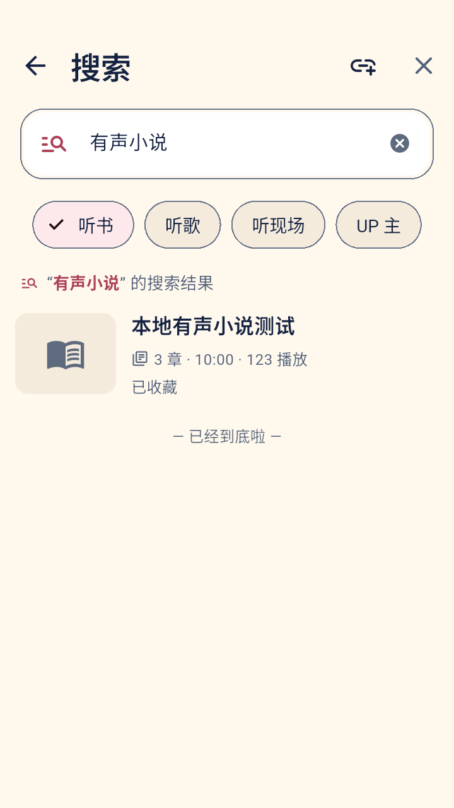
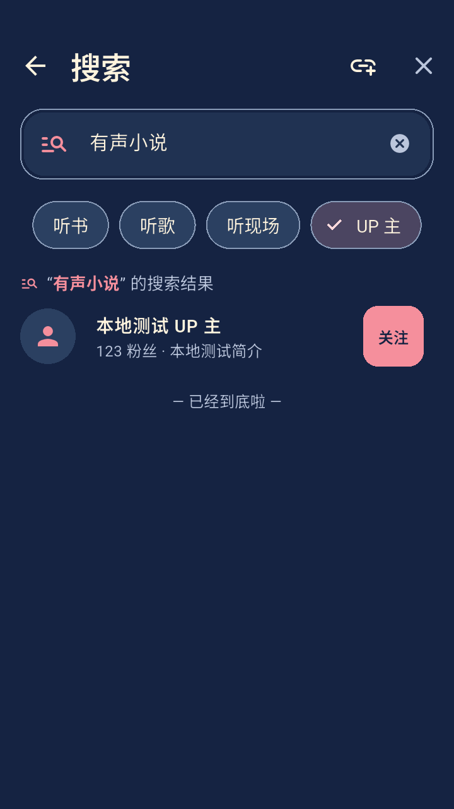

# 搜索四分类与 UP 主页模式验收

日期：2026-10-24。起点：`c68d2d6`。项目：Blisten；应用版本仍为 1.0.0+1。

## 交付行为

- 搜索页一层四个并列入口：听书、听歌、听现场、UP 主，未搜索时也可以选 UP 主。前三项沿用既定文案，分别代表听书、歌曲、演唱会。
- 删除原来各模式内的“内容结果 / UP主”切换。分类切换保留输入；显示新分类的加载/失败/空状态，旧请求不会覆盖新选择。
- UP 搜索独立请求用户接口，列表分页按 mid 去重；失败保留已加载内容，页尾可以重试同一页，不在滚动期间自动重复失败请求。
- UP 主页默认沿用搜索页最近的内容模式，并显式提供三模式选择。切换重载第一页；分页、详情及空态搜索使用当前模式。
- 修复模式快速切换时旧合集初始化覆盖新分页游标的竞争：在异步初始化前登记新游标，旧请求只修改自己的游标。
- 复用现有视觉、ChoiceChip 和错误状态，补“清空搜索”可读名称；无新艺术资产、依赖、数据迁移、权限、播放策略或正式安装包。

设计依据：[四分类设计](../superpowers/specs/2026-10-24-search-categories-design.md)、[视觉规范 v1.1](../design/bting-design-system-v1.md)。

## 自动化检查

环境沿用本机 Flutter 3.38.10 / Dart 3.10.9、JDK 17、专用 API35 x86_64 Android 模拟器。未操作手机。

| 检查 | 结果与范围 |
| --- | --- |
| 初始行为复现 | 12 项新组件用例在旧实现因不存在一级 UP 分类/主页模式选择而失败，然后实现后通过 |
| 真实 BiliApi 游标竞争 | 修复前期望 season200/page2，却得到旧 season100/page2；修复后通过，使用受控网络客户端和真实内容服务 |
| 定向组件 | 38 项通过、1 项条件截图跳过；包括四分类、请求隔离、分页重试、详情模式、空/错误态、小屏大字及键盘 |
| 原生 `audio_modes_test.dart` | 退出0；5个功能场景通过：三模式播放、进度、离线、搜索/导入进入实际播放 |
| 原生 `visual_design_test.dart` | 最终退出0；4个深浅主题/大字场景通过，共32张截图；搜索相关8张入库 |
| `tool/test-android.sh unit` | 退出0；静态分析无问题，117 项单元/组件通过、1 项条件截图跳过；10 项打包元数据检查通过 |

相对审查基线新增 15 项常规测试：搜索 6 项、UP 主页 8 项、真实服务游标 1 项。原有搜索行为和布局测试按新的一级分类更新，视频筛选和播放规则测试保留。

完整单元记录：`build/desktop-tests/20261024-112258-79963/run.log`。定向与失败复现日志：`build/search-categories/`。原始日志保留本机、不入 Git；所有测试内容与账号均为合成数据。

## 实测截图

普通字号四项同排；200% 字体自动换行，四项与关注操作仍可到达。UP 长名称与说明按既有规则省略，不遮挡关注操作。已实际查看普通/大字和深浅主题截图；组件测试另覆盖320dp窄屏、键盘展开和长名称/签名。原生截图为720×1280、320dpi设备的应用表面，使用固定测试内容。

  

[全部8张搜索截图](../screenshots/search-categories/)；原生日志：`build/search-categories/native-modes.log` 与 `native-visual.log`。首次视觉脚本因只等待关注数据变化、未等待按钮重绘而失败；已改为等待可见按钮并清理每例关注状态，最终复验通过。大字截图经实际发现→更多导航进入，等待控件动画稳定再捕获。

[证据哈希摘要](search-categories-evidence.json)记录生产文件、测试与本地日志、最终截图的 SHA-256；不以截图或测试通过代替线上可用性承诺。

## 本轮范围

- 本次不修改上一轮全面审查中的凭据日志、断点保存、加载中暂停、旧 Android 通知等问题，也不声称已完成全面改进方案。
- UP 搜索分页覆盖原审查 R18；UP 主页允许显式更改模式，但关注数据仍不持久化内容类型，不称 R13 已完整解决。
- 本轮接口结构未改，未新增真实 B 站联网测试；模拟器的 UP 结果来自本机固定接口。未验证真实账号、ARM 真机、全程 TalkBack、长时后台和厂商电量策略。
- 没有生成正式签名包或四种发布 APK，没有推送远程仓库。
