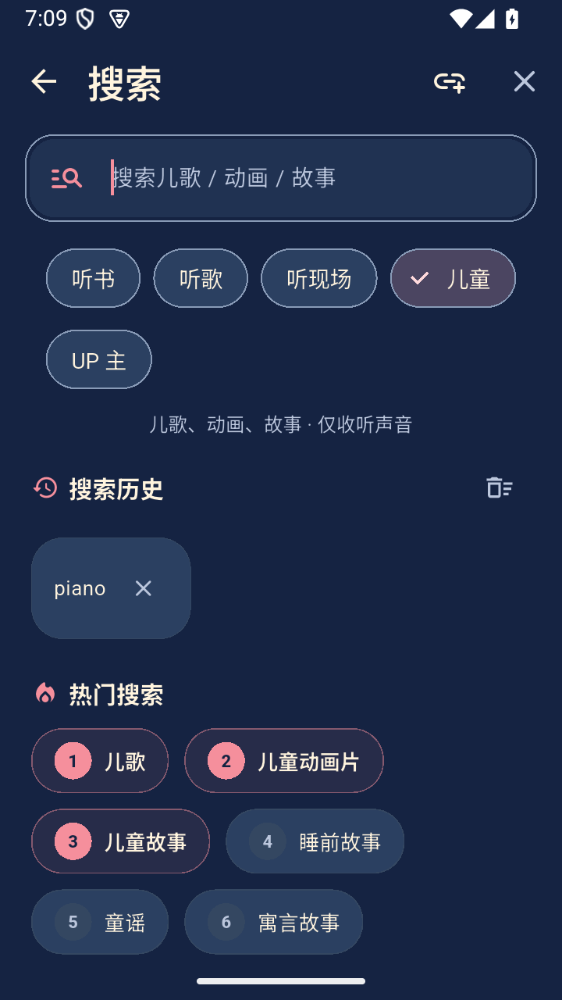
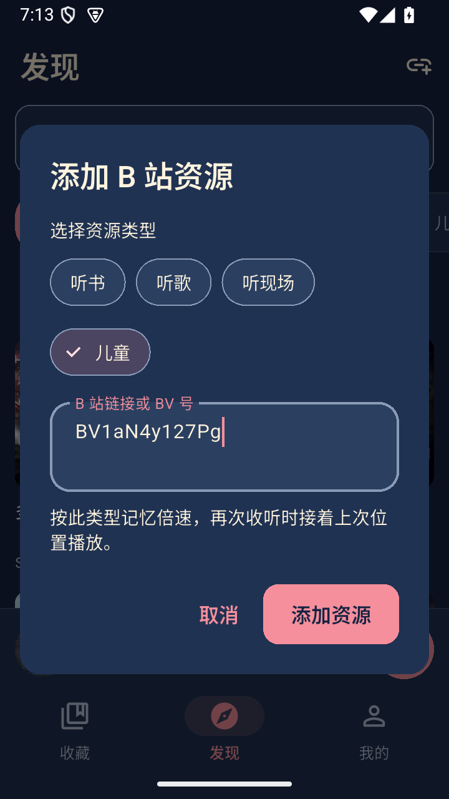
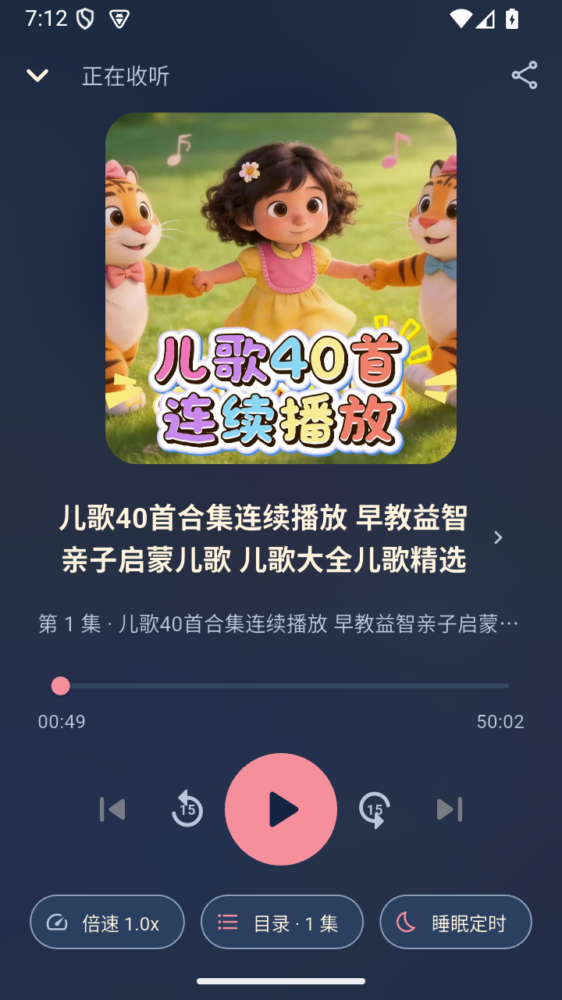

# B听 1.1.0 验收记录

状态：**1.1.0 已公开发布**，源码回归、四正式 APK、GitHub CI 与 13 附件匿名下载核验均通过；旧版检查更新受测试网络出口匿名 API 限流影响，等待配额恢复后复验。起点 `d287ae6`，分支 `codex/children-v1.1`；目标 `1.1.0+2` / `v1.1.0`，继续使用已有正式签名证书。

## 改动范围

新增儿童模式与儿歌、动画片、故事快捷搜索。儿童默认 1×、独立倍速、统一断点续播、手动收藏；动画只播放音频。UP 主保持独立搜索入口。旧模式和数据键不变。

1.1 起新增进入首页后的自动检查更新与 24 小时成功检查间隔，手动检查不受间隔限制。统一提示、请求去重、超时及正式版本与下载链接校验。更新经浏览器下载、Android 确认安装。

**已发布 1.0.0 没有自动提示代码**；不能通过服务器发布补上。旧版手动识别真实 1.1、新版自动提示夹具测试、正式 1.1 检查最新是三个不同验收项。

## 已有证据

- RED：儿童类型读取、独立倍速、短儿歌搜索、缓存/UP 类型保留及新增分类缺失均产生实际失败；更新非正式版本和不可信链接用例同样失败。自动提示控件的 9 项行为用例在空实现上失败。
- GREEN：儿童相关 63 项通过，1 项可选截图跳过；后续搜索键盘、更新服务/控件、身份与既有布局检查 71 项通过。各次检查存在重复，不能累加为独立用例数。
- 发现并修复 320dp/200% 大字/280dp 键盘下儿童说明引发的 27px 溢出；输入时暂隐藏辅助说明，五分类与输入仍可操作，两主题复验通过。
- 专用 API35 x86_64 模拟器保留正式 1.0.0（versionCode 1），测试快照 `blisten-v100-before-v110` 保存成功，供候选验收后还原并验证公开更新。未操作个人手机。
- 初次全量检查因三处新代码缺少大括号的 lint 提示停止，后续修复与复验结果另记；不作为全量通过。

## 本版回归结果

| 检查 | 结果与证据 |
| --- | --- |
| Flutter 静态分析 | 0 issues；`build/v1.1-readiness/analyze-final.txt` |
| Flutter 单元/组件 | 349 通过，1 项可选截图跳过；`build/desktop-tests/20261024-183434-31438` |
| Python 脚本检查 | 94 通过；同上。截图步骤调整后运行器 5 项另行复验通过 |
| Android debug 构建/lint | 0 errors、12 项既有 warnings；`build/desktop-tests/20261024-183154-30697` |
| Android 确定性原生回归 | 85 项行为检查、20 个测试进程均通过；`build/desktop-tests/20261024-183754-32463`，包括儿童播放/缓存/焦点/跨进程续播与更新提示 |
| 真实 B 站联网 | 六组关键词（听书、歌曲、演唱会、儿歌、动画片、故事）搜索及歌曲、儿童原生播放通过；`build/desktop-tests/20261024-190150-37338`。儿童资源 `BV1aN4y127Pg` 实播位置达到 3 秒 |
| 自动更新提示 | Android 原生环境通过真实 Dio → 本机 HTTP 夹具 → SharedPreferences → 弹窗链路；夹具版本 9.0.0 明确标为测试数据，未发布虚假 Release |
| 更新请求寿命 | 永不响应的测试适配器在总计 15 秒超时后关闭客户端；并覆盖失败静默、手动重试、去重、24 小时间隔、返回首页/恢复前台等 |

初次真实联网失败是专用模拟器没有默认网络；连接实际扫描到的 AndroidWifi 后，系统确认网络 VALIDATED，上述联网重跑通过。没有跳过线上检查或改为仅验证本地夹具。旧版 1.0.0 数据另保存在线快照 `blisten-v100-online-before-v110`，供正式升级及真实更新识别。

## 正式 APK 与远程 CI

APK 对应源码提交 `e9f0a06f43d7e0df21e50ed14a9e7407b7874ab8`，构建清单记录 `git_dirty=false`；`v1.1.0` 固定指向此提交，后续补充验收文档不移动标签。应用包名 `com.bting.audio`、版本 `1.1.0+2`，四包延续 1.0 正式证书，SHA256 `da58f45d2a4309fb420b8508c97b6652f64a8417e4c2d876f5303d3e08bc2ee0`。

| APK | 字节 | 十进制 MB |
| --- | ---: | ---: |
| arm64-v8a | 27,986,643 | 27.99 |
| armeabi-v7a | 24,851,015 | 24.85 |
| x86_64 | 30,271,553 | 30.27 |
| universal | 77,048,807 | 77.05 |

四包元数据、签名、ABI、64 位 ELF/ZIP 的 16KiB 静态规则通过。12 项 mpv/helper 打包映射与冻结六个 SO 逐字节一致；每包 20 项原生资产、16 个许可证文件一致，未发现测试 TLS 夹具、额外 SO 或禁止资产。原生源码归档复用上一版，74 项内部摘要、25 项配方/通知、三份 ABI 清单和六个库再次核对一致；没有声称本轮重新编译三 ABI 或再次离线重建。

[GitHub CI 40088428354](https://github.com/AtomHH86/Blisten/actions/runs/40088428354) 对上述精确源码提交的 Analyze and test、Android build and lint 均成功。CI 中 Android 音频库由固定源码独立构建。

### 成品界面与系统媒体状态

- 先从模拟器拉取真实 1.0 universal 安装文件，SHA256 与公开旧包一致，再执行 1.1 x86_64 覆盖安装，拉取后与待发布新包哈希一致。旧《种子》收藏、100% 进度与深色主题保留。
- 正式包“发现 → 儿童 → 搜索 → 儿歌热词 → 结果 → 儿童内容详情 → 开始收听”实测通过；详情和播放器均显示“集”，初始 1.0×。
- 儿童播放后台位置从 19,557ms 增至 44,750ms；暂停保存 46,499ms。手动收藏后结束进程，重新打开收藏恢复到 47,916ms，未从头开始。
- 导入 `BV1aN4y127Pg` 并选择儿童，短儿歌《小星星》作为儿童资源加入收藏，正式播放器状态 PLAYING。
- universal 覆盖安装后拉取文件哈希一致；三项收藏、14%/2%/100% 进度、深色主题保留，短儿歌在 19,770ms 继续播放。退出记录未见本轮崩溃/ANR，crash buffer 为空。
- 原始 XML、截图和系统媒体证据在 `build/v1.1-readiness/apk-blackbox/`，公开摘要与证据哈希见 Release 附件 `apk-runtime-verification.json`。没有把 debug 测试包状态冒充正式 APK 结果。

### 发布与更新识别

发布附件包含四 APK、构建清单、校验表、原生对应源码、静态/运行/CI 及源码验证 JSON，共 13 项。[Release v1.1.0](https://github.com/AtomHH86/Blisten/releases/tag/v1.1.0) 已公开；服务端 13 项大小、digest 以及全部匿名下载回读的 SHA-256 均与本机匹配，记录在 `build/v1.1-readiness/github-download-verification.json`。回读脚本首轮因本机目录前缀缺失而停止，修正后完整重跑通过，未将首次失败算作验证成功。

旧版 1.0 真实检查更新暂未通过：独立 Android HTTPS 探针确认 DNS/TLS 成功，但同一公开 API 返回 403、`x-ratelimit-remaining=0`，预计 19:43:15（北京时间）重置。先前 DNS 握手日志不足以单独确定应用请求失败原因，临时 DNS 设置已撤回。未向应用提供 Token、未改写公开 Release、未关闭 TLS 校验；等待接口恢复后继续验收。自动未来版本弹窗已由上文标明的原生 HTTP 夹具独立验证。

## 正式包画面

  

## 覆盖边界

本机可运行的目标为 API35 x86_64 模拟器。ARM64/ARMv7 真机、其他 Android API、实际 16KiB 系统、真实电话/蓝牙/厂商电池策略、完整 TalkBack、人工听音和性能/耗电基准未因此获得覆盖。既有原生依赖与离线冷起播约 9 秒的已知边界沿用 [1.0 验收记录](2026-10-24-apk-release.md)，未在本次扩展中承诺解决。
