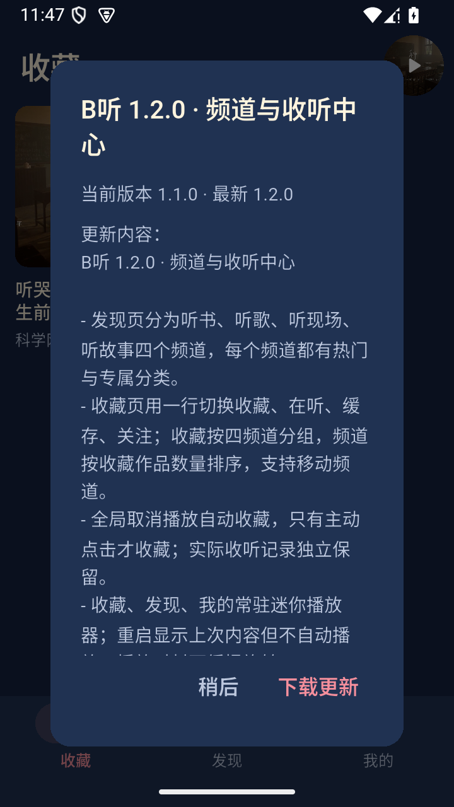
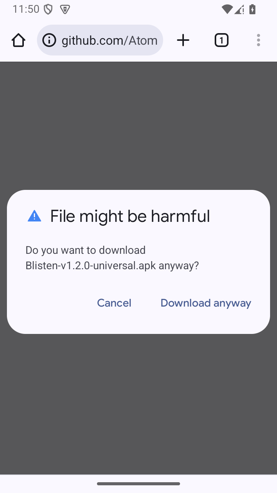
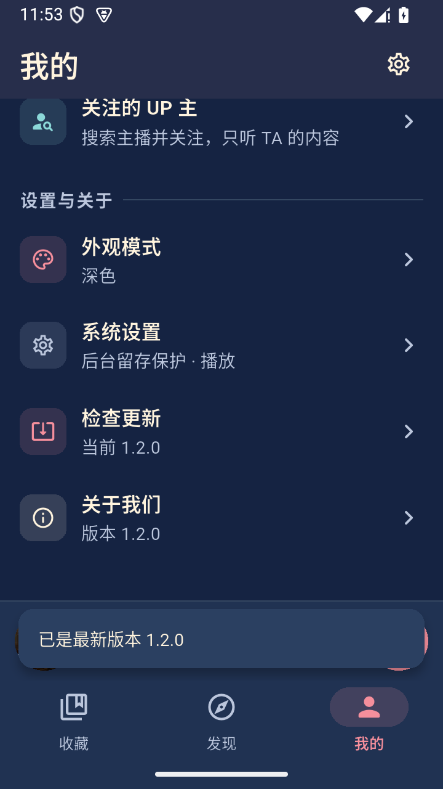

# B听 1.2.0 Android 验收记录

状态：**B听 1.2.0 已公开发布。源码回归、四个正式签名 APK 的构建与独立静态检查、精确源码 CI，以及正式 x86_64 / universal 包已列明的覆盖安装、数据保留、静默冷启动、播放与暂停检查通过。最终 runtime 报告已带明确限制定稿；13 个附件匿名重新下载及哈希核对通过，旧版自动/手动识别本版、新版显示已是最新均已实测。** 浏览器下载入口和独立下载包安装的具体范围见下文，不将这些结果扩写为 Android 安装器界面验收。

目标版本 `1.2.0+3`，正式包名 `com.bting.audio`，构建源码为 `bc5413e02b970d793dc50e3c46f1d581d9aa4797`，构建 manifest 记录 `git_dirty=false`。开发从 `a214b80` 的 `codex/channels-library-v1.2` 分支开始；完整功能范围见 [已确认方案](../superpowers/specs/2026-10-24-channels-favorites-recent-design.md)。历史 1.1 验收不作为本版功能通过证据。

## 本轮范围

- 发现页四频道与各自专属分类；搜索、更多、导入的频道继承及分类恢复。
- 收藏页单行收藏／在听／缓存／关注；四频道收藏分组、稳定排序及移动频道。
- 四种模式全局手动收藏；实际收听、收藏和缓存分开，零秒重播仍保留听过记录。
- 三主页面常驻迷你播放器：当前会话、本地上次预览和无历史状态；重启不自动播放。
- 原签名、原包名覆盖升级；四 APK、精确源码 CI、发布附件与更新识别。

## 源码与本机回归

开发阶段的定向检查和下表存在交叉用例，不相加作为测试总数。最终生产代码的本机检查与后续仅测试代码的调整分别保留证据；不将多个批次描述为一次 `all` 命令成功退出。

| 检查 | 已确认结果 | 证据 |
| --- | --- | --- |
| 全项目静态分析、host 单元/组件、Python 工具测试 | 分析 0 issues；host 393 通过、1 项既有可选截图跳过；Python 94 通过；该批退出 0 | `build/v1.2-readiness/unit-candidate-console.txt`；`build/desktop-tests/20261025-010819-73233` |
| Android 调试构建与 lint | 构建通过；lint 0 errors、12 项既有 warnings；该批退出 0 | `build/v1.2-readiness/lint-candidate-console.txt`；`build/desktop-tests/20261025-010934-74258`；`build/app/reports/lint-results-debug.txt` |
| 确定性原生回归 | 按下述批次覆盖 25 个独立进程/阶段，包含跨进程 seed/verify 和真实原生广播探针 | 见分批明细 |
| 真实 B 站联网冒烟 | 六项检索有结果；music 与 children 的原生播放位置均推进到 3000 ms；该批退出 0 | `build/v1.2-readiness/online-final-console.txt`；`build/desktop-tests/20261025-010448-71638` |
| 最终源码 GitHub CI | `headSha` 精确等于 `bc5413e02b970d793dc50e3c46f1d581d9aa4797`；`Analyze and test`、`Android build and lint` 两个 job 均 completed/success，整个 run success | `dist/v1.2.0+3/ci-verification.json`；[GitHub Actions run 40115359365](https://github.com/AtomHH86/Blisten/actions/runs/40115359365) |

25 个原生进程/阶段按主测试入口计数：24 个 Flutter drive 阶段，加 1 个 Activity 销毁后的原生 noisy 广播探针；每个跨进程 seed/verify 各算一次。重复复验不增加这一分母，runner 的 setup/teardown 数也不当作业务用例数。

| 批次 | 通过范围与整体退出状态 |
| --- | --- |
| `all-final-console.txt`；`20261025-002712-63484` | 更新夹具、凭据存储、原生 TLS、四模式共前 4 个阶段通过。随后 retry 用例暴露旧测试夹具缺少既往收听 checkpoint，整批退出 1；该批不是全套通过证据。 |
| `manual-native-final.txt` | 独立手动收藏套件 10 个行为用例通过，runner `+12` 含 setup/teardown。覆盖四模式实际收听、分 P/完成、移动/移出与缓存收听持久化。 |
| `native-final-resume-console.txt`；`20261025-004442-67243` | 从 retry 到 panels 的 18 个 Flutter 阶段通过，另有 Activity 销毁后的后台 lifetime/noisy 广播探针通过。覆盖可靠性、生命周期竞争、music/audiobook 静默预览重启、续播重启、缓存清理/恢复、音频焦点、定时、设置、详情 CID 与面板。末尾主视觉捕获到缓存空态在 200% 字号下溢出 31 px，整批退出 1。 |
| `visual-candidate-console.txt`；`20261025-011006-73231` | 最终面板套件通过，产出 8 张深浅主题、320dp、200% 字号面板截图。该批后续主视觉仍因频道选择依赖前一场景状态而失败，整批退出 1，不能称整批通过。 |
| `main-visual-final-console.txt`；`20261025-011451-75603` | 显式选择各场景目标频道后，最终主视觉套件全部通过，该批退出 0；包含真实拒绝通知权限后的前台导航与播放场景。 |

后期唯一生产代码改动是 `1d1da40`：让内嵌缓存页空态在大字号下可滚动，并增加布局回归。后续 `fc8e991` 与 `bc5413e` 仅调整测试和截图时序/场景前置条件；相关面板、主视觉均已重跑。上述分批结论不表示所有原生阶段在同一最终提交上重新运行了一遍，也不表示存在一次完整 `all` 的退出 0 记录。

联网检索的实际结果为：

| 频道与关键词 | 返回数量 |
| --- | ---: |
| 听书：三体 有声小说 | 17 |
| 歌曲：种子 | 20 |
| 演唱会：演唱会 全场 | 20 |
| 儿童：儿歌 小星星 | 20 |
| 儿童：儿童动画片 | 17 |
| 儿童：儿童故事 | 17 |

music 与 children 的联网播放证据来自 debug 包原生播放器，分别记录 `positionMs=3000`；正式签名包的主动播放结论在下文单列，不能由这项 debug 冒烟替代。搜索数量只代表这次实网执行时的结果。

## 已发现问题、修复与像素检查

- 首次原生端到端用例仍查找旧文案“添加资源”，已改为当前“添加到收藏”定位并重跑；保留 `20261025-001652-60881` 的失败记录。
- 手动收藏/缓存测试曾在真实音频推进与正常延迟保存之前断言。已改为等待原生正向推进、达到所请求 seek 位置并观察真实记录与持久化；未插入伪进度或跳过断言。最终独立手动收藏套件通过。
- retry 的失败替换场景需要明确的既往收听 checkpoint；补足夹具后，恢复批次中的 retry 通过。
- 独立审查发现的三处生产边界已修复：最近 100 项按真实收听时间淘汰、详情读取移动后的频道、发现离线备用读取未收藏记录的新频道。
- 更新提示曾截图到弹窗绘制前一帧；增加绘制等待。自定义定时面板截图增加键盘收起后的稳定等待。截图内容和控件断言分别核验。
- 主视觉确实发现内嵌缓存空态在 200% 字号下溢出 31 px；`1d1da40` 修复可滚动布局。随后主视觉暴露频道状态沿用导致的测试前置条件问题，`bc5413e` 改为显式选择，最终主视觉通过。

最终主视觉产出 52 张截图；主执行者与独立审查者实际查看了其中 15 张关键样本，并追加检查 2 张。最终面板 8 张已检查实际像素。覆盖重点包括深浅主题、大字、小屏、收藏/在听/缓存/关注、播放与静默预览、章节/倍速/定时面板。这里不声明全部 52 张主截图均已逐张审看，也不以截图文件存在代替像素检查。

README 使用其中 3 张代表截图，保存于 [1.2 截图目录](../screenshots/bting-v1.2/README.md)。这些画面均来自 API35 x86_64 专用模拟器的 debug 包与固定测试数据；正式签名包的实网运行证据在下文单列，不将夹具画面描述为线上内容或 ARM 真机截图。

## 正式签名包与原生来源

四个 APK 已在 `dist/v1.2.0+3/` 生成。manifest 记录干净源码 `bc5413e02b970d793dc50e3c46f1d581d9aa4797`；本地原始 manifest 另存于 `build/v1.2-readiness/build-manifest-original.json`，公开候选 manifest 仅移除了 `flutter.flutterRoot` 本机路径，其余字段与 APK 未改动。

| 文件 | 字节数 | SHA256 |
| --- | ---: | --- |
| `Blisten-v1.2.0-arm64-v8a.apk` | 28,052,343 | `bcfbad2a809614952f82b802a344a5b0ffd13009fe0ad77780a4d07e92678280` |
| `Blisten-v1.2.0-armeabi-v7a.apk` | 24,916,715 | `222098bbefb5b11584940d7756ce0972d543d8a541ac36839394c588b918c649` |
| `Blisten-v1.2.0-x86_64.apk` | 30,337,253 | `45f4654eb6ae1c4608e09068813d9241b9a31825a031333d91040f432f674ccb` |
| `Blisten-v1.2.0-universal.apk` | 77,245,579 | `5911c1fb9144613bbd33304878c06005cade69fc4b36bf539ad4286046346d4c` |

独立静态检查 `apk-native-verification.json` 为 `passed`：4 个 APK、12 个音频库映射通过；包名、`versionName=1.2.0`、`versionCode=3`、ABI 集合、签名、manifest 与实际包哈希一致，检查前后输入未改变。证书 SHA256 为 `da58f45d2a4309fb420b8508c97b6652f64a8417e4c2d876f5303d3e08bc2ee0`。minSdk 24、targetSdk 36、`debuggable=false`；16 KiB ELF/ZIP 兼容性为静态检查结果，不代表实际 16 KiB 系统运行测试。

原生源码未改，明确复用 `dist/v1.0.0+1` 的源码归档及对应六个冻结原生库。最终 `dist/v1.2.0+3/source-archive-verification.json` 已绑定本版最终源码 SHA，并重新核验归档及成员哈希、当前构建配方/通知、锁定来源归档、原生 manifest、构建输入与六个冻结库。归档 SHA256 为 `bf2d36734cf334b0c3310708130be5dff4c879ec7dee700aaca16a55369a9e41`。本版没有重新编译原生库，也没有重新执行原版全部离线来源准备或逐个展开的上游源码文件比较，不作跨主机字节复现声明。早期 `source-reuse-preflight.json` 绑定较早提交，最终来源结论以 dist 中的本版报告为准。

## 正式包覆盖升级与运行检查

- 升级前专用模拟器中的正式包为 `1.1.0+2`；实际安装文件 SHA256 为 `7052903bc5484decf653be474a9f6f094e5514393d67be6412fba15426484862`，与公开 1.1 universal 一致；保留快照 `blisten-v110-before-v120`。
- 使用本版 x86_64 正式包 `install -r` 覆盖升级成功。安装后拉回的 APK SHA256 为 `45f4654eb6ae1c4608e09068813d9241b9a31825a031333d91040f432f674ccb`，与本版 manifest 一致；证据 `installed-Blisten-v1.2.0-x86_64.json`。
- `before-upgrade-state.json`、`upgraded-before-launch-state.json`、`upgraded-after-launch-state.json` 对照确认收藏、收听进度、完成标记与主题一致；本次基线包含 1 项收藏。不能据此声称遍历了所有用户数据形态或登录凭据迁移。
- 冷启动后能够从真实 UI 进入“上次收听”预览；正式包的 media session 为 `state=NONE`、`active=false`，没有自动开始播放。证据位于 `build/v1.2-readiness/apk-blackbox/`。
- 正式 x86_64 包中，主动播放原有《种子》资源，media session 持续为 `PLAYING`，两次采样位置从 `13674 ms` 推进到 `30258 ms`；返回主界面后迷你播放器保持播放态，已观察到封面旋转。随后主动暂停，media session 为 `PAUSED`、位置 `90259 ms`。证据 `apk-blackbox/formal-play-a-media.txt`、`formal-play-b-media.txt`、`formal-paused-media.txt` 及相应真实 UI 截图。
- 收藏页的收藏／在听／缓存／关注四个入口均能切换；发现页已检查歌曲、演唱会、儿童三个频道的实时分类与真实返回内容，显示与对应频道一致。证据包括 `apk-blackbox/formal-library-playing.xml`、`formal-recent-playing.xml`、`formal-cache.xml`、`formal-following.xml`、`formal-music.xml`、`formal-concert.xml`、`formal-children.xml`。
- 对照儿童资源 `BV1aN4y127Pg`（“一闪一闪亮晶晶，小星星，儿歌 小星星”）已通过搜索→详情→正式包播放，media session 为 `PLAYING`、位置 `3250 ms`。该资源以 `mode=children` 新增到最近收听，持久化位置为 `2000 ms`，真实收听时间戳为 `1792863130530`；没有自动加入收藏，收藏仍为原有 1 项。证据 `apk-blackbox/known-child-search.xml`、`known-child-detail.xml`、`known-child-playing-media.txt`、`known-child-unfavorited-state.json`。
- 正式包中主动收藏儿童对照资源后，收藏由原有 1 项变为 2 项，儿童资源仍在播放；证据 `child-manually-favorited-state.json` 与 `apk-blackbox/child-manually-favorited-media.txt`。随后真正完成“移出收藏”确认流程，详情恢复“添加到收藏”，收藏只剩原有《种子》1 项；儿童资源在移出前后仍为 `PLAYING`，采样位置从 `10000 ms` 推进到 `27500 ms`，其最近收听保留为 `27000 ms`。证据 `apk-blackbox/child-remove-dialog.xml`、`child-remove-confirmed.xml`、`child-remove-confirmed-media.txt` 与 `child-remove-confirmed-state.json`。
- universal 安装前正式包已确认暂停于 `36250 ms`；最终基准 `pre-universal-final-state.json` 包含原有《种子》收藏和儿童最近收听 `36250 ms`。本版 universal 正式包 `install -r` 成功，拉回的安装文件 SHA256 为 `5911c1fb9144613bbd33304878c06005cade69fc4b36bf539ad4286046346d4c`，匹配 manifest；`universal-installed-state.json` 的收藏、最近进度、完成标记与主题同最终基准一致。冷启动显示儿童 `00:36` 的本地预览，正式包 media session 为 `NONE`、`active=false`，没有自动播放。证据 `installed-Blisten-v1.2.0-universal.json`、`apk-blackbox/universal-cold-home.xml`、`universal-cold-home-media.txt`。
- universal 从儿童 `36250 ms` 的本地预览主动恢复播放，两次 media session 采样为 `PLAYING`、位置分别为 `38050 ms` 与 `60014 ms`；最终主动暂停为 `PAUSED`、位置 `61000 ms`。最终状态仍仅原有《种子》1 项收藏，儿童最近收听保留为 `61000 ms`。证据 `apk-blackbox/universal-resumed-a-media.txt`、`universal-resumed-b-media.txt`、`universal-final-paused-media.txt` 与 `universal-final-state.json`。
- 正式包 `com.bting.audio` 的 crash buffer 为空；本轮读取的 exit-info 共 3 条，均为 `USER REQUESTED / FORCE STOP`，没有 CRASH/ANR 记录。已保存候选快照 `blisten-v120-tested`。这是本轮模拟器观察范围，不构成无崩溃保证。证据 `formal-crash-buffer.txt` 与 `formal-exit-info.txt`。
- 最终 `dist/v1.2.0+3/apk-runtime-verification.json` 状态为 `passed_with_documented_limits`，版本 `1.2.0+3`、源码 SHA 与构建一致，包含正式包安装身份、实际检查范围、在线资源及硬件覆盖限制和 18 份证据 SHA256；`finalize-runtime.py` 的实际断言已通过。该状态保留已记录的限制，不扩写为全部资源或全部设备通过。

本轮曾产生中间或误命名材料：`child-removed-state.json`、`before-universal-state.json` 不作为移出确认或 universal 数据保留的最终基准；`child-final-paused-media.txt` 实际仍为 `PLAYING`，不作为暂停通过证据；早期 `child-unfavorited-state.json` 也不作为本次移出后保留最近记录的证据。上述结论只使用已明确列出的最终状态和实际内容。

## 在线资源边界

本轮正式包检查中，热门儿童资源“牙齿痛了怎么办？熊猫姐姐儿童益智早教儿歌动画片”首次播放和一次重试均返回 `BiliApiException`，没有播放成功。具体原因尚未定位，现有证据不足以归因为网络、版权或风控。

失败后应用保留原会话并显示“暂时无法播放”及重试入口，没有把失败资源写入最近收听；可查 `apk-blackbox/formal-child-failure.xml`、`child-retry.xml` 与 `child-retry-state.json`。后续对照资源 `BV1aN4y127Pg` 的成功链路单独记为通过，不覆盖这个未成功样本。本轮不宣称所有 B 站资源均可播放；这一尚未定位的单资源失败保留为在线资源可用性边界，不撤销已有明确证据支持的实现功能验收结果。

## 公开发布与回读

| 项目 | 已确认结果 |
| --- | --- |
| 最终源码 CI | 已通过；run `40115359365`，exact SHA 如上 |
| 最终 runtime 与附件集合 | 已完成；runtime 带明确限制并绑定最终源码和正式 APK；本地目录精确 13 个附件，`validate-release-bundle.py` 检查通过，源码和 CI 均为 `bc5413e02b970d793dc50e3c46f1d581d9aa4797` |
| GitHub tag | `v1.2.0` 已推送，解引用 commit 精确为 `bc5413e02b970d793dc50e3c46f1d581d9aa4797`，与构建及 CI 一致 |
| Release 发布 | [v1.2.0](https://github.com/AtomHH86/Blisten/releases/tag/v1.2.0) 已公开发布；release ID `422884075`，发布时间 `2026-10-24T17:42:38Z`，`draft=false`、`prerelease=false`；latest 与 tag API 返回同一发布及附件集合 |
| 完整校验和 | 已在全部本地附件定稿后统一生成并验证；`SHA256SUMS` 精确覆盖其余 12 个发布附件 |
| 匿名公开回读 | `github-download-verification.json` 状态 `passed`；13 个附件均为新匿名下载，实际落盘字节、大小与 SHA256 均匹配最终本地文件，GitHub 提供的全部附件 digest 也一致；完成时间 `2026-10-24T17:46:21.456178+00:00` |
| 公开更新识别 | 恢复专用模拟器中的正式 `1.1.0+2`，自动弹窗和“我的 → 检查更新”均实际显示当前 `1.1.0`、最新 `1.2.0`；安装本版后实际显示“已是最新版本 1.2.0” |
| 浏览器移交与独立安装 | 下载按钮打开真实 `Blisten-v1.2.0-universal.apk` Release URL，并出现浏览器通用 APK 下载确认框；取消该次浏览器下载。另将独立匿名下载的 GitHub universal 包通过 ADB 覆盖安装，拉回的实际安装字节与本版 SHA256 匹配；未操作 Android 安装器界面 |

首次匿名 API 请求因 GitHub 额度耗尽返回 HTTP 403（remaining=0）；等待额度恢复后曾遇到一次 TLS EOF。保持证书验证启用，按普通重试完成上述匿名与公开更新检查，不将失败尝试记为通过。

旧版公开自动检查的前置条件是恢复专用 `1.1` 快照，并只删除“上次成功检查”的 24 小时冷却字段；已核对其他偏好不变。自动提示、手动提示和新版本反馈均访问真实公开 Release；本地更新夹具结果不替代这项实网检查。

公开结果的精简可追溯摘要见 [发布与更新证据](evidence/v1.2-public-verification.json)，包含远程 tag 的实际 commit、13 附件哈希、检查范围与证据文件哈希；不附账号信息或原始偏好文件。下面三张为同一 API35 x86_64 专用模拟器上的正式包/浏览器真实公开检查画面，分别为旧版自动发现 1.2、浏览器下载确认、新版最新提示，区别于上文 debug 固定夹具截图。

  

新版最新提示采用已查看像素的 `public-latest-frame-3.png` 及对应 `public-new-latest-feedback.xml`。较早 `public-new-latest-visible.png` 只捕获到“检查中”，不作为已是最新的截图证据。

## 覆盖边界

本机原生测试目标为专用 API35 x86_64 模拟器。ARM 真机、其他 Android API、实际 16 KiB 系统、硬件蓝牙/电话/厂商电池策略、完整 TalkBack、人工听音和耗电基准未测；本轮源码、静态检查、原生位置推进与模拟器结果不替代这些环境的运行结果。

按用户顺序要求，先完成 Android 交付；PWA、微信小程序和 iOS 的评估在 Android 交付后进行，本记录不提前给出这些平台的实现或可行性结论。
