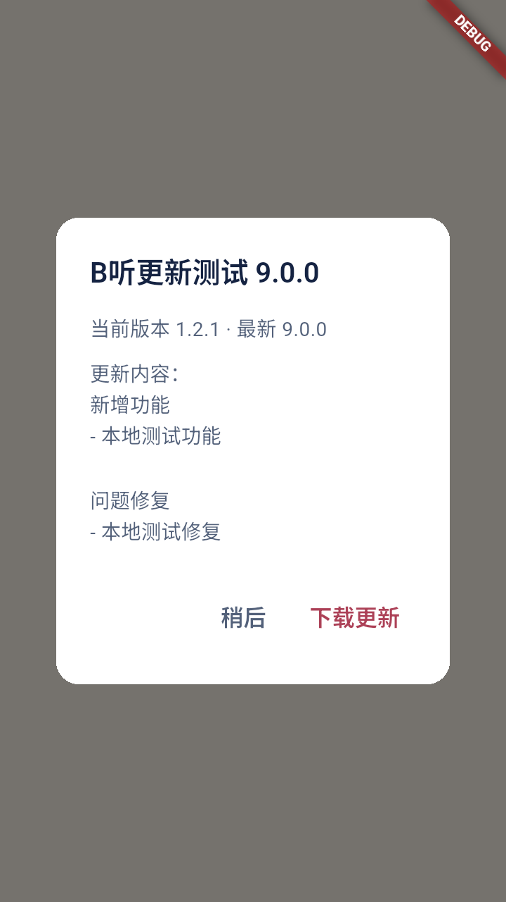
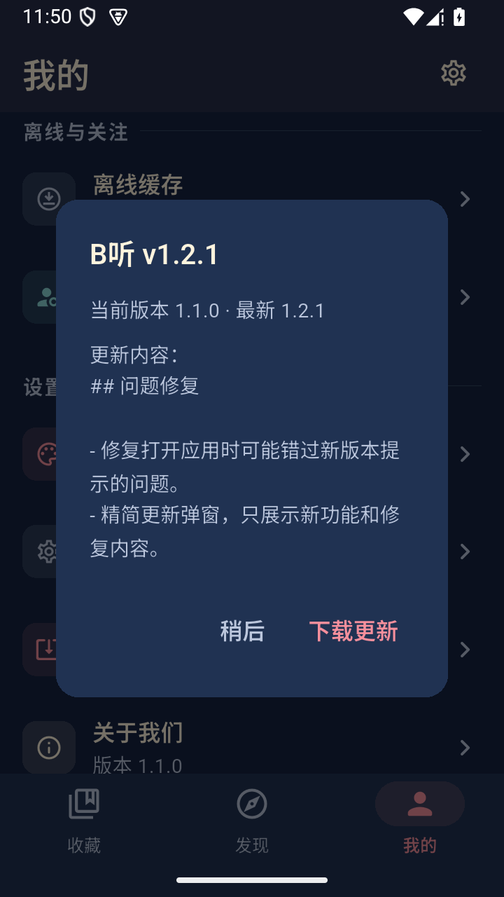

# B听 1.2.1 更新修复验收

状态：已公开发布 [v1.2.1](https://github.com/AtomHH86/Blisten/releases/tag/v1.2.1)。四个 APK 来自干净提交 `831832bf17e3be8ed2872e182ba49e6470480f0b`，版本 `1.2.1+4`，包名与专用签名不变。后续 Web/iOS 预览提交不包含在该标签和四个 APK 中。

## 修复与复现

用户确认 1.1 手动能发现更新，冷启动没有提示。原实现会因持久化的 24 小时成功检查时间跳过检查；现在每次冷启动检查一次，同一进程的页面切换不重复提示。自动失败仍不打断收听，手动检查可随时重试。

新弹窗只提取“新增功能”“问题修复”段落，未结构化说明使用简短通用提示。公开 1.2.0 和 1.2.1 的 Release 正文也已整理为用户功能和修复内容。旧 1.1 的已安装逻辑不能远程改写，需要先手动升级一次。

## 验证结果

| 范围 | 结果与证据 |
| --- | --- |
| 修复前后定向测试 | 红测 47 通过、9 失败；修复后 56 通过。`build/v1.2.1-readiness/update-{red,green}.txt` |
| 完整 host 回归 | 400 通过、1 项既有可选截图跳过；静态分析 0 issues；Python 94 通过。`unit-full.txt` |
| Android 构建与 lint | 本地通过，精确源码 CI 的两个 job 均成功：[40120305278](https://github.com/AtomHH86/Blisten/actions/runs/40120305278) |
| 原生自动弹窗 | 专用 API35 x86_64 模拟器中 3 个实际 testWidgets 通过。保留一分钟内的成功时间，真实 HTTP 本地夹具返回 9.0.0 后自动弹窗；技术段落未显示。`native-update.txt` |
| 正式包覆盖升级 | x86_64 从 1.2.0 覆盖升级，再安装 universal；拉回安装字节与发布 APK 哈希一致。收藏、进度、完成标记与主题保留；冷启动不播放音频 |
| 正式包近期检查后再次启动 | 未删除成功时间：上次检查 `1792866456784`，冷启动 `1792866550021`，新成功时间 `1792866553700`。证明原 24 小时窗口内仍发起真实检查 |
| 手动检查 | 一次匿名 GitHub 额度耗尽返回 403；额度恢复后真实手动检查显示“已是最新版本 1.2.1” |
| 旧版识别正式发布 | 恢复既有 1.1 快照后手动检查，实际显示当前 1.1.0、最新 1.2.1 及本版修复说明；本轮不声称旧版自动逻辑已经修复 |
| 四 APK 静态检查 | 版本、包名、签名、ABI、16 KiB ELF/ZIP 与 12 个音频库映射通过；原生库和对应源码归档复用经过重新核验 |
| 完整发布回读 | 13 项附件全部重新匿名下载，大小及 SHA-256 与本地一致，latest 与 tag 指向同一正式 Release；已公开、非草稿、非预发布 |

上述本地证据均位于 `build/v1.2.1-readiness/`。发布附件包含 manifest、完整校验和、源码归档及验证摘要。可追溯公开结果见 [证据 JSON](evidence/v1.2.1-public-verification.json)。本轮没有把前一版本全部音频用例重新执行，不以历史测试充当本版重新通过。

## 界面证据与限制

左图是新代码的原生本地更新夹具（模拟 9.0.0）；右图是旧 1.1 正式包从公开 GitHub 发现 1.2.1。两张均检查了实际像素，来源分开记录。

 

运行目标是专用 API35 x86_64 模拟器。ARM 包完成静态校验，未做本轮 ARM 真机、厂商电池策略或真实 16 KiB 系统测试。匿名 GitHub 接口受网络和共享额度影响；修复检查时机不保证每次请求均成功。不将本轮结果扩写为所有设备无问题，也不包含 PWA、iOS 发布验收。
